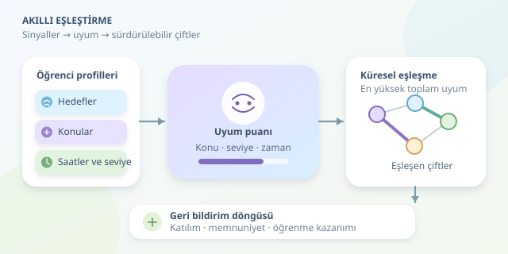

Aynı konuyu öğrenmek isteyen iki öğrenciyi bulmak kolaydır; birlikte verimli çalışacak iki öğrenciyi bulmak ise biraz çöpçatanlık, biraz matematik ister. Eşler arası öğrenme platformlarında amaç, yalnızca takvimleri çakıştırmak değil, öğrencilerin birbirini destekleyebileceği sürdürülebilir çalışma ilişkileri kurmaktır. Peki algoritma bu uyumu nasıl tahmin eder?
``
## Önce “uygun partner” ne demek?

Eşleştirme algoritmasının ilk işi hesaplama yapmak değil, başarıyı tanımlamaktır. Sınava hazırlanan iki öğrenci benzer bilgi düzeyinden yararlanabilirken, mentorluk oturumunda belirli bir seviye farkı avantaj sağlayabilir. Dolayısıyla tek bir evrensel uyumluluk formülü yoktur; hedef, oturumun türüne göre değişir.

Öğrenci profili; öğrenme hedefleri, konu ilgileri, uygun saatler ve bilgi düzeyi gibi sinyaller içerebilir. Ancak her sinyal aynı şekilde kullanılmamalıdır:

| Ölçüt | İşlevi | Örnek |
|---|---|---|
| Ortak zaman | Zorunlu koşul | En az bir ortak oturum |
| Konu ilgisi | Benzerlik sinyali | İkisi de algoritma çalışıyor |
| Bilgi düzeyi | Hedefe bağlı tercih | Akran çalışmasında yakın seviye |
| İletişim biçimi | Tercih sinyali | Yazılı veya sesli çalışma |

**Zorunlu koşullar**, adayları eler; **tercihler** ise kalan adayları sıralar. Bu ayrım önemlidir: Mükemmel konu uyumu, hiç ortak zamanı olmayan iki öğrenciyi aynı masaya oturtamaz.

## Uyum puanının matematiği

Konu kümelerinin benzerliği için Jaccard katsayısını kullanabiliriz:

$$J(A,B)=\frac{\vert A\cap B\vert }{\vert A\cup B\vert }$$

İki öğrencinin konuları tamamen aynıysa sonuç 1, ortak konu yoksa 0 olur. Boş kümelerde ise uygulamanın açık bir varsayım belirlemesi gerekir; örneğimiz bu durumda sıfır döndürüyor.

Bilgi düzeylerini 1–5 arasında tanımlayalım. Seviye yakınlığını $L_{ij}=1-\vert s_i-s_j\vert /4$ ile, zaman benzerliğini de uygun saat kümelerinin Jaccard değeriyle ölçelim. Böylece örnek puanımız şöyle olur:

$$w_{ij}=0.45J_{ij}+0.35L_{ij}+0.20T_{ij}$$

Bütün bileşenler aynı aralıkta olduğundan ağırlıklar yorumlanabilir. Ancak bu katsayılar bilimsel sabitler değildir; başlangıç varsayımlarıdır. Mentorluk senaryosunda seviye yakınlığı yerine hedeflenen seviye farkına uygunluk ölçülmelidir.

## Yerel favoriden küresel eşleşmeye

Her öğrenciyi bir düğüm, uygun öğrenci çiftlerini ağırlıklı kenarlar olarak düşünelim. Aradığımız sonuç, hiçbir öğrencinin iki farklı çifte girmediği bir **eşleşmedir**.

Herkesi sırayla en yüksek puanlı partnerine bağlayan açgözlü yaklaşım, ilk öğrenciye harika bir partner verirken diğerlerini kötü seçeneklere mahkûm edebilir. Maksimum ağırlıklı eşleştirme ise çiftleri birlikte değerlendirir. Genel öğrenci havuzunda Blossom ailesindeki algoritmalar kullanılabilir; mentor ve öğrenci gibi iki ayrı grup varsa problem iki parçalı grafa dönüşür.

## Python ile küçük bir prototip

Aşağıdaki örnek, `pip install networkx` ile kurulabilen NetworkX kütüphanesini kullanır. Her profil benzersiz bir `id`, 1–5 arasında `seviye` ve küme türünde `konular` ile `saatler` alanları taşımalıdır. Saatler, aynı saat dilimindeki standart oturum kimlikleri olmalıdır.

```python
from itertools import combinations
import networkx as nx


def jaccard(a, b):
    return len(a & b) / len(a | b) if a | b else 0.0


def eslestir(ogrenciler):
    graf = nx.Graph()
    graf.add_nodes_from(o['id'] for o in ogrenciler)

    for a, b in combinations(ogrenciler, 2):
        if not (a['saatler'] & b['saatler']):
            continue

        konu = jaccard(a['konular'], b['konular'])
        seviye = 1 - abs(a['seviye'] - b['seviye']) / 4
        zaman = jaccard(a['saatler'], b['saatler'])
        puan = 0.45 * konu + 0.35 * seviye + 0.20 * zaman

        if puan >= 0.55:
            graf.add_edge(a['id'], b['id'], weight=puan)

    return nx.max_weight_matching(
        graf, maxcardinality=True, weight='weight'
    )
```

Kod önce ortak zamanı olmayan çiftleri eler, sonra düşük puanlı bağlantıları kaldırır. `maxcardinality=True`, önce mümkün olan en fazla çifti kurmayı, ardından bu büyüklükteki eşleşmeler arasında toplam puanı yükseltmeyi seçer. Yalnızca toplam ağırlığı önceliklendirmek isterseniz bu seçeneği kapatmalısınız. Dönüş değeri, eşleşen öğrenci kimliklerinden oluşan çiftler kümesidir; bazı öğrenciler eşleşmeyebilir.

## Gerçek hayatta algoritmayı kim eğitir?

Asıl öğretmen, kullanım geri bildirimidir. Oturuma katılım, karşılıklı memnuniyet ve öğrenme kazanımı birlikte izlenmelidir. Sadece tıklanma oranını artırmak, öğrenmeyi artırmak anlamına gelmez. Başlangıç düzeyindeki öğrencilerin sürekli eşleşmeden kalıp kalmadığı da ayrıca incelenmelidir.

Büyük havuzlarda bütün çiftleri karşılaştırmak $O(n^2)$ aday üretir. Önce konu ve zaman üzerinden aday havuzunu daraltmak maliyeti azaltabilir; fakat iyi eşleşmeleri yanlışlıkla eleme riski taşır. Son olarak öğrencilerin tercih değiştirebilmesi, eşleşmeyi reddedebilmesi ve yalnızca gerekli verilerin tutulması gerekir. Algoritma bir tanıştırma görevlisidir; çalışma arkadaşlığının patronu değil.



