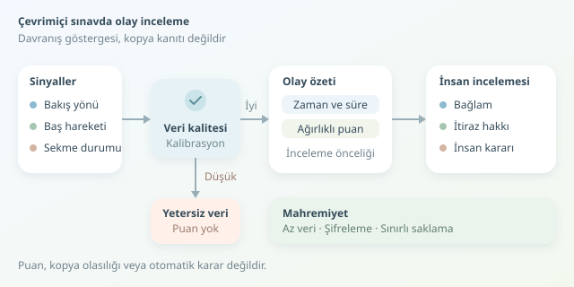

Çevrimiçi sınavda kameraya bakmamak kopya çekmek anlamına gelir mi? Keşke mesele bu kadar basit olsaydı! Öğrenci düşünüyor, soruyu başka ekrandan okuyor veya yalnızca gözlerini dinlendiriyor olabilir. Göz izleme ve davranış analizi sistemleri sınav güvenliğine katkı sağlayabilir; ancak görevleri zihin okumak değil, bağlam içinde incelenmesi gereken olayları görünür kılmaktır.



``

## Göz izleme gerçekte neyi ölçer?

Göz izleme, bakışın yönünü veya ekrandaki yaklaşık konumunu tahmin eder. Özel donanımlar göz bebeği ve kızılötesi yansımaları kullanabilirken standart kameralar genellikle yüz işaretleri, göz bölgesi ve baş pozundan yararlanır. Dolayısıyla sıradan bir web kamerası, hassas bir laboratuvar cihazıyla aynı doğruluğu sunmaz.

Sistem önce kalibrasyonla görüntüdeki özellikleri bilinen ekran noktalarıyla eşleştirir. Ardından zaman içinde bakış tahminleri üretir. Aydınlatma, gözlük, kamera açısı ve kişinin hareketleri hata payını değiştirir. Kalibrasyon bozulduğunda modelin özgüveni yüksek görünse bile tahmini yanlış olabilir.

Buradaki temel ayrım şudur: **Ölçülen şey davranışın bir göstergesidir; davranışın niyeti değildir.** Ekran dışına bakmak doğrudan kopya kanıtı sayılamaz.

## Davranış analizi: Tek kare yerine zaman çizelgesi

Davranış analizi, olayların sıklığına, süresine ve birlikte gerçekleşmesine bakar. Örneğin uzun bir bakış sapmasıyla sınav sekmesinin görünmez olması aynı zaman aralığında gerçekleşebilir. Ancak bu birliktelik bile tek başına ihlal ispatlamaz.

| Sinyal | Ne anlatabilir? | Neyi kanıtlamaz? |
|---|---|---|
| Bakış yönü | Ekran dışına yönelme | Yasak kaynağa bakıldığını |
| Baş hareketi | Pozisyon değişimi | Başka biriyle iletişimi |
| Sekme görünürlüğü | Sınav sayfasının görünmez olması | Hangi uygulamanın kullanıldığını |
| Yüzün görünmemesi | Görüntü kaybı veya kadraj sorunu | Kasıtlı gizlenmeyi |

Tarayıcıdaki görünürlük olayları tüm bilgisayar etkinliğini göstermez. Benzer şekilde yüzün görünmemesi, bağlantı veya kamera sorunundan kaynaklanabilir. İyi tasarım, eksik veriyi suçlayıcı sinyale dönüştürmez.

## Basit bir inceleme puanı nasıl kurulur?

Örnek bir yaklaşımda bakış sapması oranını $g$, sekmenin görünmez kaldığı süre oranını $o$, belirgin baş hareketi oranını $h$ olarak tanımlayalım. Hepsi $[0,1]$ aralığında olsun:

$$R = w_g g + w_o o + w_h h$$

Burada ağırlıklar negatif değildir ve $w_g + w_o + w_h = 1$ koşulunu sağlar. **$R$, kopya olasılığı değil, örnek bir inceleme önceliğidir.** Ağırlıklar ve eşikler gerçek verilerle doğrulanmadan kullanıma alınmamalıdır.

Aşağıdaki Python kodu, önceden hesaplanmış pencere özetlerini birleştirir; düşük görüntü kalitesinde puan üretmez:

```python
def inceleme_ozeti(g, o, h, kalite):
    degerler = (g, o, h, kalite)
    if not all(0 <= x <= 1 for x in degerler):
        raise ValueError("Girdiler 0 ile 1 arasında olmalı")

    if kalite < 0.8:
        return {"durum": "yetersiz_veri", "puan": None}

    puan = 0.45 * g + 0.35 * o + 0.20 * h
    return {
        "durum": "olay_ozeti",
        "puan": round(puan, 3)
    }
```

Kodun yaptığı şey sınırlıdır: normalize edilmiş ölçümleri özetlemek. Kamera görüntüsü işlemez, niyet çıkarmaz ve yaptırım önermez. Kalite eşiği ile ağırlıklar tamamen öğretici örnektir. Üretimde zaman damgaları, kalibrasyon durumu ve teknik kesintiler de ayrıca saklanmalı; inceleyene olayların bağlamı gösterilmelidir.

## Yanlış alarm neden büyük mesele?

Başarıyı yalnızca genel doğrulukla değerlendirmek yanıltıcıdır. Bin öğrenciden yalnızca onunun ihlal yaptığı varsayılsın. Sistem bunların dokuzunu bulurken diğer öğrencilerden doksan dokuzunu yanlış işaretlerse, toplam yüz sekiz uyarının yalnızca dokuzu doğrudur. Uyarıların isabeti yaklaşık yüzde sekizdir!

Bu nedenle kesinlik, duyarlılık ve yanlış pozitif oranı birlikte değerlendirilmelidir. Testler farklı ışık koşullarını, kamera kalitelerini ve erişilebilirlik ihtiyaçlarını kapsamalıdır. Nöroçeşitlilik veya istemsiz hareketler, standart davranış varsayımlarını geçersiz kılabilir. Ayrıca model güncellemeleri, önceki başarı ölçümlerini otomatik olarak geçerli kılmaz.

## Güvenlik kadar mahremiyet de tasarlanır

Gereksiz kayıt toplamamak, mümkünse cihaz üzerinde işlemek, aktarımı şifrelemek ve saklama süresini sınırlamak temel mühendislik kararlarıdır. Hangi verinin neden toplandığı açıkça anlatılmalı; uygulanabilir alternatif sınav yöntemleri sunulmalıdır. Açık rıza tek başına her veri işleme faaliyetini hukuka uygun hâle getirmez; uygun hukuki dayanak ayrıca değerlendirilmelidir.

Son söz: Güvenilir sistem, en çok alarm üreten sistem değildir. Bulgularını açıklayan, belirsizliğini gösteren, öğrenciye itiraz imkânı sağlayan ve disiplin kararını yalnızca otomatik puana dayandırmayan sistemdir. Dijital gözetmen yardımcı olabilir; hâkim koltuğuna oturmamalıdır.
