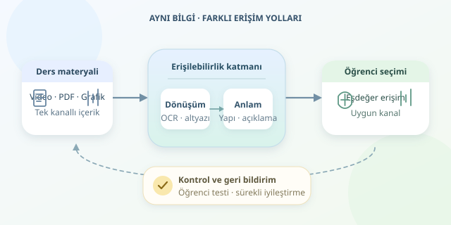

Bir ders videosunu sessiz izlediğinizi veya matematik kitabını ekranı görmeden okumaya çalıştığınızı düşünün. İçerik aynı kalır, fakat bilgiye ulaşmanın yolu değişir. Görme veya işitme engelli öğrenciler için erişilebilirlik teknolojileri tam olarak bu yolları çoğaltır. Yazılımın görevi, öğrenciyi materyale uydurmak değil; materyalin önündeki engelleri kaldırmaktır.

``

## Temel fikir: Aynı bilgi, farklı kanallar

Dijital materyaller genellikle bilgiyi görsel ve işitsel kanallara dağıtır. Ancak önemli bir kavram yalnızca renkle, yalnızca konuşmayla veya yalnızca bir animasyonla anlatıldığında tek kanala bağımlılık oluşur. Çözüm, öğrenme hedefini koruyarak eşdeğer alternatifler sunmaktır. Eşdeğerlik, bütün öğrencilerin aynı arayüzü kullanması değil, aynı bilgiye erişebilmesidir.

Evrensel Öğrenme Tasarımı bu yaklaşımı destekler: İçeriği farklı biçimlerde sunmak ve öğrencinin uygun olanı seçebilmesini sağlamak. Ekran okuyucular anlamsal HTML yapısından yararlanır; yenilenebilir Braille ekranları metinsel içeriği dokunsal olarak sunabilir. Bu nedenle düzgün başlık yapısı, gösterişli bir tasarımdan daha değerlidir.

| Materyal | Olası engel | Yazılımsal uyarlama |
|---|---|---|
| Taranmış kitap | Metin seçilemiyor | OCR ve yapısal düzenleme |
| Ders videosu | Konuşmalar duyulamıyor | Altyazı ve metin dökümü |
| Hücre diyagramı | Görsel ilişkiler anlaşılamıyor | Kısa alternatif ve ayrıntılı açıklama |
| Etkileşimli sınav | Fare zorunlu tutuluyor | Klavye erişimi ve görünür odak |




## Dönüşüm hattı nasıl çalışır?

İlk adım envanter çıkarmaktır: PDF, slayt, video, grafik ve sorular belirlenir. Ardından içerikler makinece işlenebilir biçimlere dönüştürülür. OCR, taranmış sayfadaki harfleri tanıyabilir; fakat okuma sırasını, tablo ilişkilerini ve formülleri kusursuz çıkaracağı varsayılmamalıdır. Otomatik çıktı, öğretmen veya erişilebilirlik uzmanı tarafından kontrol edilmelidir.

Konuşma tanıma sistemleri ilk altyazı taslağını üretir. Zaman kodları, konuşmacı değişimleri ve anlam taşıyan sesler ayrıca düzenlenir. Örneğin “[alarm çalıyor]” bilgisi bazı deneylerde öğrenme açısından kritiktir. İşaret dili videosu bazı öğrenciler için önemli bir seçenekken, anlamlı görsel olaylar için sesli betimleme gerekebilir. Tercihleri tek bir engel kategorisinden tahmin etmek yerine öğrenciyle konuşmak gerekir.

Basit bir kapsam göstergesi $K = a/n$ olarak tanımlanabilir. Burada $a$ uygun alternatifi hazırlanmış öğelerin, $n$ ise incelenen toplam öğelerin sayısıdır; $n>0$ olmalıdır. On öğenin sekizi uyarlanmışsa $K=0.8$ olur. Ancak bu oran kalite puanı değildir: Hatalı altyazı da sayacı artırabilir!

## Python ile küçük bir yayınlama aracı

Aşağıdaki örnek, hazırlanmış içerikten HTML üretir. `ders.vtt` altyazı dosyasının önceden oluşturulması gerekir. Kod zorunlu alanları denetler, metinleri HTML açısından güvenli biçimde yerleştirir ve videoya altyazı bağlar.

```python
from pathlib import Path
from html import escape

lesson = {
    'title': 'Hücreyi Tanıyalım',
    'alt': 'Çekirdek ve hücre zarını gösteren şema.',
    'description': 'Çekirdek merkezde, hücre zarı dış sınırdadır.',
    'transcript': 'Öğretmen: Hücre zarı madde geçişini düzenler.'
}

for field, value in lesson.items():
    if not value.strip():
        raise ValueError(f'Eksik içerik: {field}')

captions = Path('ders.vtt').read_text(encoding='utf-8-sig')
if not captions.startswith('WEBVTT'):
    raise ValueError('WEBVTT başlığı bulunamadı.')

d = {key: escape(value, quote=True) for key, value in lesson.items()}
page = f'''<!doctype html>
<html lang="tr">
<meta charset="utf-8">
<title>{d['title']}</title>
<main>
<h1>{d['title']}</h1>

<p id="aciklama">{d['description']}</p>
<video controls aria-label="Hücre konulu ders videosu">
  <source src="ders.mp4" type="video/mp4">
  <track kind="captions" src="ders.vtt" srclang="tr"
         label="Türkçe" default>
</video>
<h2>Dersin metin dökümü</h2>
<p>{d['transcript']}</p>
</main>
</html>'''
Path('ders.html').write_text(page, encoding='utf-8')
```

Dosyaları aynı klasörde tutup yerel bir HTTP sunucusuyla açabilirsiniz. Bu kontrol yalnızca altyazı başlığını doğrular; zaman damgalarını veya içeriğin doğruluğunu sınamaz. Örnekteki kısa açıklamalar gerçek ders için genişletilmelidir. Matematikte ise formülleri yalnızca resim olarak vermek yerine MathML veya erişilebilirlik desteği yapılandırılmış MathJax kullanılabilir.

## Son kontrolü öğrencilerle yapın

WCAG 2.2 AA, web tabanlı materyaller için yararlı bir hedeftir; fakat birkaç otomatik test tam uyumluluk kanıtı değildir. Sayfayı yalnızca klavyeyle gezin, ekran okuyucuyla başlıkları inceleyin, videoyu sessizde izleyin. Altyazıların önemli görüntüleri kapatmadığını, büyütülen metnin taşmadığını ve renklerin tek bilgi taşıyıcısı olmadığını denetleyin.

Öğrenci kayıtlarını dış hizmetlere gönderirken mahremiyeti, kurum politikasını ve gerekli izinleri değerlendirin. En önemlisi, farklı erişim ihtiyaçları olan öğrencilerle kullanılabilirlik testi yapın. İyi erişilebilirlik sihirli bir eklenti değil; içerik üretimi, yazılım geliştirme ve geri bildirimin birlikte çalıştığı sürekli bir süreçtir.
