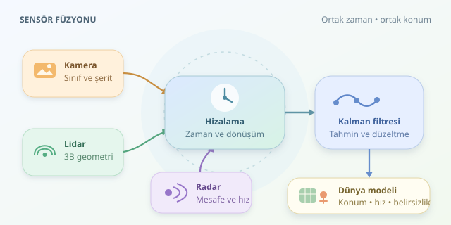

Bir insansız araç düşünün: Kamera “ileride bir bisikletli var” diyor, lidar mesafeyi ölçüyor, radar ise yaklaşma hızını bildiriyor. Peki bu üç tanık aynı kişiyi mi anlatıyor? Sensör füzyonu, farklı diller konuşan bu algılayıcıları ortak bir dünya modelinde buluşturur. Amaç yalnızca daha fazla veri toplamak değil, belirsizliği yönetmektir.

``

## Sensörler neden birbirini tamamlar?

Her sensör çevrenin farklı bir özelliğini ölçer. Hiçbiri tek başına kusursuz değildir; birlikte çalışmaları, iyi kurulmuş bir yazılım ekibine benzer: görev dağılımı sonucu güçlendirir.

| Sensör | Güçlü olduğu bilgi | Temel sınırlama |
|---|---|---|
| Kamera | Renk, sınıf, şerit ve tabela | Işık koşulları; tek görüntüden belirsiz derinlik |
| Lidar | Hassas üç boyutlu geometri | Sis, yağış ve yüzey yansıtıcılığı |
| Radar | Mesafe ve radyal hız | Genellikle daha düşük açısal çözünürlük |




Radarın ölçtüğü radyal hız, nesnenin bütün hız vektörü değildir; görüş doğrultusundaki bileşenidir. Benzer şekilde, kameranın çizdiği sınırlayıcı kutu doğrudan metre cinsinden konum sayılmaz. Füzyonun ilk şartı, ölçümlerin gerçekte ne söylediğini bilmektir.

## Önce aynı yer ve aynı zaman

Sensörlerin koordinat sistemleri farklıdır. Dış kalibrasyon, sensörler arasındaki dönme ve ötelemeyi belirler. Homojen koordinatlarla dönüşüm şöyle yazılır:

$$p_{araç}=T_{araç,sensör}p_{sensör}$$

Kameraya izdüşüm için ayrıca iç kalibrasyon ve mercek bozulması modeli gerekir. Böylece lidar noktalarının görüntüde hangi bölgeye düştüğü bulunabilir.

Zaman eşleştirmesi de en az geometri kadar önemlidir. Saatte 72 kilometreyle ilerleyen araç, 50 milisaniyede bir metre yol alır! Ölçümler ortak zamana taşınmalı; aracın kendi hareketi telafi edilmeli, hareketli nesneler için takip modeli kullanılmalıdır. Aksi hâlde düzgün bir bisikletli, üç ayrı hayalet gibi görünebilir.

## Birleştirme hangi seviyede yapılır?

| Yaklaşım | Birleştirilen bilgi | Temel ödünleşim |
|---|---|---|
| Erken füzyon | Ham veriler | Zengin bilgi, yüksek eşleştirme maliyeti |
| Ara seviye füzyon | Öğrenilmiş özellikler | Esneklik, eğitim gereksinimi |
| Geç füzyon | Nesneler ve izler | Modülerlik, ayrıntı kaybı |

Güncel sistemler özellikleri kuşbakışı bir ızgarada buluşturabilir. Buna BEV denir. Ancak ortak ızgara tek başına tutarlılık sağlamaz: nesne kimlikleri, zaman ve belirsizlik de birlikte yönetilmelidir.

## Matematik: Tahmin et, ölç, düzelt

Bir nesnenin durumunu $x=[p_x,p_y,v_x,v_y]^T$ ile gösterelim. Hareket modeli sonraki konumu tahmin eder; süreç gürültüsü, beklenmeyen manevraları temsil eder. Ölçüm modeli ise durumu sensörün gözlediği büyüklüğe dönüştürür.

Doğrusal Kalman güncellemesinin merkezinde şu kazanç vardır:

$$K=P^-H^T(HP^-H^T+R)^{-1}$$

Burada $P^-$ tahmin belirsizliği, $R$ ölçüm belirsizliği, $H$ ölçüm matrisidir. Güncelleme:

$$x^+=x^-+K(z-Hx^-)$$

Düşük ölçüm belirsizliği, ilgili doğrultuda ölçüme daha fazla güvenilmesini sağlar. Radarın mesafe-açı ölçümü gibi doğrusal olmayan durumlarda EKF veya UKF kullanılabilir. Öncesinde veri ilişkilendirme gerekir: Hangi ölçüm hangi ize aittir? Mahalanobis uzaklığıyla kapılama, olası eşleşmeleri belirsizliğe göre sınırlar.

## Python ile küçük bir füzyon adımı

Aşağıdaki örnek, önceden tahmin edilmiş durumu iki konum ölçümüyle düzeltir. Veriler yapaydır; aynı koordinata ve zamana taşındıkları, hatalarının bağımsız olduğu varsayılır.

```python
import numpy as np

H = np.array([[1., 0., 0., 0.],
              [0., 1., 0., 0.]])

def update(x, P, z, R):
    innovation = z - H @ x
    S = H @ P @ H.T + R
    K = np.linalg.solve(S, H @ P).T
    x = x + K @ innovation
    A = np.eye(len(x)) - K @ H
    P = A @ P @ A.T + K @ R @ K.T
    return x, P

x = np.array([9., 2., 1., 0.])
P = np.diag([4., 4., 1., 1.])
x, P = update(x, P, np.array([10., 2.]),
              np.diag([0.16, 0.16]))  # lidar
x, P = update(x, P, np.array([10.2, 1.8]),
              np.diag([0.36, 2.25]))  # radar
```

`solve`, açık matris tersinden kaçınır; Joseph biçimindeki kovaryans güncellemesi sayısal kararlılığı destekler. Radarın konum kovaryansı gerçek uygulamada polar ölçümden uygun dönüşümle elde edilir. Kamera burada konum güncellemez; sınıflandırma ve eşleştirmeye katkı sağlayabilir.

## Tutarlı model, dürüst belirsizlik

Sonuç yalnızca nesne listesi değildir: konum, hız, sınıf, iz kimliği ve belirsizlik içeren dinamik bir dünya modelidir. Doluluk haritası serbest, dolu ve bilinmeyen alanları da temsil edebilir.

Ortak kalibrasyon hataları ölçümleri ilişkili yapabilir; bağımsızmış gibi birleştirmek aşırı güven üretir. Sensör kaybı, gecikme ve aykırı ölçümler izlenmelidir. İyi füzyon, üç sensörün çoğunluk oylaması değil; her tanığın hangi koşulda güvenilir olduğunu bilen dikkatli bir hakemdir.
