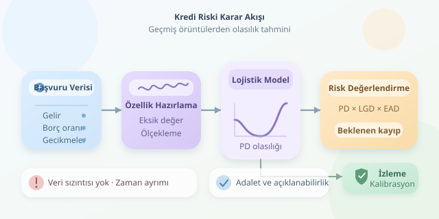

Bir bankaya kredi başvurusu yaptığınızda, perde arkasında küçük bir veri dedektifi çalışır: kredi skorlama modeli. Gelirinizi, borçlarınızı ve ödeme alışkanlıklarınızı inceleyerek gelecekteki ödeme güçlüğünü tahmin etmeye uğraşır. Ancak kristal küresi yoktur; yalnızca geçmiş örüntüler, istatistik ve dikkatle hazırlanmış veriler vardır. Gelin bu dijital dedektifin nasıl düşündüğünü keşfedelim.

``

## Önce hedefi tanımlayalım

Kredi riski, tek başına “iyi müşteri” veya “kötü müşteri” etiketi değildir. Önce ölçülebilir bir olay belirlenir: Örneğin, başvurudan sonraki 12 ay içinde ödemenin en az 90 gün gecikmesi temerrüt kabul edilebilir. Kesin tanım, ürüne ve ilgili düzenlemelere bağlıdır.

Modelin tahmin ettiği **temerrüt olasılığı**, yani PD, şöyle gösterilir:

$$PD=P(Y=1\mid X)$$

Burada $X$ başvuru anında bilinen özellikleri, $Y=1$ ise tanımlanan temerrüt olayını temsil eder. Yüzde 4 PD, kişinin kesinlikle ödeme yapamayacağı anlamına gelmez; benzer risk düzeyindeki çok sayıda başvuruda yaklaşık yüzde 4 temerrüt beklenmesi anlamına gelir.

Beklenen parasal kayıp için iki bileşen daha gerekir:

$$EL=PD\times LGD\times EAD$$

LGD, temerrütte kaybedilen pay; EAD, temerrüt anındaki risk tutarıdır. PD yüzde 4, LGD yüzde 60 ve EAD 100.000 TL ise beklenen kayıp 2.400 TL olur. Bu, tek müşterinin gerçekleşmiş zararı değil, istatistiksel beklentidir.

## Veriden özelliğe: Malzeme kalitesi önemlidir

Model girdileri arasında aylık gelir, borç/gelir oranı, geçmiş gecikme sayısı ve kredi limiti kullanım oranı bulunabilir. Aynı gelir düzeyinde daha yüksek borç yükü, farklı bir ödeme kapasitesine işaret edebilir. Ancak ilişkiler her müşteri grubunda aynı değildir.

| Özellik | Anlattığı durum | Dikkat noktası |
|---|---|---|
| Borç/gelir oranı | Gelire göre borç yükü | Gelirin güncelliği |
| Geçmiş gecikmeler | Ödeme davranışı | Yalnızca geçmiş kayıtlar |
| Limit kullanım oranı | Kullanılan limitin toplam limite oranı | Dönemsel dalgalanma |

Başvuru sonrasındaki gecikmeleri girdi olarak kullanmak **veri sızıntısıdır**: Sınavdan önce cevap anahtarına bakmak gibi! Eksik değerleri doldurma ve ölçekleme işlemleri de yalnızca eğitim verisinden öğrenilmelidir.

## Python ile açıklanabilir bir başlangıç

Lojistik regresyon güçlü bir başlangıç modelidir. Özelliklerin ağırlıklı toplamını sigmoid fonksiyonuyla olasılığa dönüştürür:

$$PD=\frac{1}{1+e^{-z}},\qquad z=b+\sum_i w_i x_i$$

Aşağıdaki örnek, belirtilen sütunları içeren bir CSV bekler. `temerrut_12ay` hedefinin bütün satırlarda tam 12 aylık gözlemle kesinleşmiş olduğu varsayılır. Zaman ayrımı, geleceği geçmişten tahmin etme senaryosunu taklit eder; aradaki yıl, eğitim etiketlerinin olgunlaşmasına alan bırakır.

```python
import pandas as pd
from sklearn.pipeline import make_pipeline
from sklearn.impute import SimpleImputer
from sklearn.preprocessing import StandardScaler
from sklearn.linear_model import LogisticRegression
from sklearn.metrics import roc_auc_score, average_precision_score

df = pd.read_csv('kredi.csv', parse_dates=['basvuru_tarihi'])
features = [
    'aylik_gelir', 'borc_gelir_orani',
    'gecikme_sayisi', 'limit_kullanim_orani'
]
target = 'temerrut_12ay'
train = df[df['basvuru_tarihi'] < '2023-01-01']
test = df[df['basvuru_tarihi'].between(
    '2024-01-01', '2024-12-31'
)]

model = make_pipeline(
    SimpleImputer(strategy='median', add_indicator=True),
    StandardScaler(),
    LogisticRegression(max_iter=1000)
)
model.fit(train[features], train[target])
pd_hat = model.predict_proba(test[features])[:, 1]
print('ROC-AUC:', roc_auc_score(test[target], pd_hat))
print('AP:', average_precision_score(test[target], pd_hat))
```

Pipeline, eksik değerleri eğitim medyanıyla doldurur, eksiklik göstergeleri ekler ve değişkenleri ölçekler. Böylece test verisinin istatistikleri eğitime karışmaz. Kodun çalışması için iki dönemde de yeterli kayıt ve hedef sınıf çeşitliliği bulunmalıdır.

## Başarı, yalnızca doğruluk değildir

Temerrüt oranı yüzde 2 ise herkese “öder” diyen model yüzde 98 doğruluk yakalar; ama riskli başvuruları bulamaz. ROC-AUC sıralama gücünü, precision-recall analizi ve AP ise pozitif sınıfı yakalama performansını değerlendirmeye yardımcı olur.

Ayrıca **kalibrasyon** kontrol edilmelidir: Yüzde 10 risk verilen grupta gerçekleşen oran gerçekten buna yakın mı? Karar eşiği; yanlış retlerin, beklenen kayıpların ve işletme kısıtlarının birlikte değerlendirilmesiyle seçilir. Gerekirse kalibrasyon ayrı bir doğrulama döneminde öğrenilir; test kümesine dokunulmaz.

## Güvenilirlik sonradan eklenen aksesuar değildir

Geçmiş veriler çoğunlukla onaylanmış kredilerin sonuçlarını içerir; reddedilen başvuruların sonucu bilinmeyebilir. Bu seçilim yanlılığı, modelin tüm başvuranlara genellenmesini zorlaştırır. Ekonomik koşullar değiştikçe performans ve kalibrasyon da izlenmelidir.

Kişisel veriler hukuka uygun, gerekli ve sınırlı kullanılmalı; ayrımcılık riski, hassas özelliklerin dolaylı temsilcileri dahil değerlendirilmelidir. Açıklamalar nedensellik kanıtı değildir. Nihai sistem, anlaşılır gerekçeler ve itiraz mekanizmaları sunmalıdır. İyi kredi modeli yalnızca risk sıralamaz; sınırlarını da bilir.



