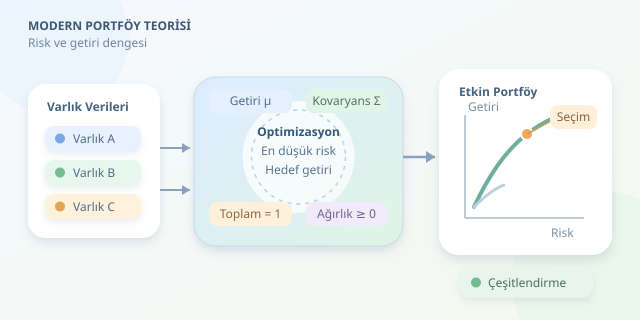

Bir portföyü yalnızca geçmişte en çok kazandıran varlıklarla oluşturmak, futbol takımını sadece golcülerden kurmaya benzer: Hücum etkileyicidir ama savunma açık verir. Modern Portföy Teorisi, yatırımların birlikte nasıl davrandığını inceleyerek bu dengeyi matematiksel bir optimizasyon problemine dönüştürür. Amaç geleceği kusursuz tahmin etmek değil, risk ve getiri arasındaki tercihleri tutarlı biçimde yönetmektir.

``

## Temel fikir: Tek başına değil, birlikte değerlendir

Harry Markowitz’in yaklaşımında portföy, varlıklara ayrılan ağırlıklarla tanımlanır. $w_i$, toplam sermayenin ilgili varlığa ayrılan oranıdır. Beklenen getiriler $\mu$ vektöründe, getirilerin birlikte değişimi ise $\Sigma$ kovaryans matrisinde tutulur.

Portföyün beklenen getirisi ve varyansı şöyledir:

$$E[R_p]=w^\top\mu, \qquad \sigma_p^2=w^\top\Sigma w$$

Getiri doğrusal bir ağırlıklı ortalamadır; risk ise varlıklar arasındaki ilişkileri de içerir. İki varlıklı durumda bunu açıkça görebiliriz:

$$\sigma_p^2=w_1^2\sigma_1^2+w_2^2\sigma_2^2+2w_1w_2\rho_{12}\sigma_1\sigma_2$$

Buradaki korelasyon $\rho_{12}$ azaldıkça çeşitlendirme potansiyeli artar. Dolayısıyla iki riskli varlık, birlikte daha dengeli bir portföy oluşturabilir. Ancak çeşitlendirme tüm riski ortadan kaldırmaz; özellikle piyasa genelindeki şoklar birçok varlığı aynı anda etkileyebilir.

## Optimizasyon problemi nasıl kurulur?

Yaygın yaklaşım, belirli bir beklenen getiri eşiğini karşılayan en düşük varyanslı portföyü bulmaktır:

$$\min_w\;w^\top\Sigma w$$

$$\text{koşuluyla}\quad \mu^\top w\ge r_{hedef},\quad \sum_i w_i=1,\quad w_i\ge0$$

Son kısıt, açığa satışı engeller. Ağırlıkların toplamının bir olması ve negatif olmaması birlikte kaldıraçsız bir portföy tanımlar. Hedef getiri, varlıkların en yüksek beklenen getirisini aşarsa bu koşullarda çözüm bulunamaz.

Farklı hedefler için problem tekrar çözülerek etkin sınır araştırılır. Ancak hedef, küresel minimum varyans portföyünün getirisinin altındaysa aynı portföy tekrar bulunabilir. Etkin portföyler, aynı riskle daha yüksek getiri elde edilemeyen seçeneklerdir.

| Yöntem | Güçlü yanı | Dikkat edilmesi gereken |
|---|---|---|
| Analitik Markowitz çözümü | Uygun eşitlik kısıtlarında hızlıdır | Matrisin terslenebilirliği önemlidir |
| Kuadratik programlama | Bu modele doğrudan uygundur | Kovaryans matrisi pozitif yarı tanımlı olmalıdır |
| SLSQP | Ek kısıtları tanımlamak kolaydır | Sayısal toleranslar kontrol edilmelidir |

Kovaryans matrisi pozitif yarı tanımlı olduğunda amaç fonksiyonu konvekstir. Doğrusal kısıtlarla birlikte bu yapı, yerel minimumların küresel minimum olmasını sağlar. Yine de sayısal çözümün gerçekten kısıtları sağladığı doğrulanmalıdır.

## Python ile minimum varyans portföyü

Aşağıdaki örnekte `prices`, sütunlarında varlıkların karşılaştırılabilir, bölünme ve temettü etkileri uygun şekilde düzeltilmiş fiyatlarını içeren bir pandas DataFrame’idir. Kod, günlük basit getirilerden yıllıklaştırılmış tahminler üretir ve açığa satışsız portföyü hesaplar. NumPy ve SciPy kurulu olmalıdır.

```python
import numpy as np
from scipy.optimize import minimize

returns = prices.pct_change(fill_method=None).dropna()
mu = returns.mean().to_numpy() * 252
cov = returns.cov().to_numpy() * 252
n = len(mu)
target = float(np.quantile(mu, 0.60))

constraints = [
    {'type': 'eq', 'fun': lambda w: w.sum() - 1},
    {'type': 'ineq', 'fun': lambda w: mu @ w - target}
]

result = minimize(
    fun=lambda w: w @ cov @ w,
    x0=np.full(n, 1 / n),
    jac=lambda w: 2 * cov @ w,
    bounds=[(0, 1)] * n,
    constraints=constraints,
    method='SLSQP',
    options={'ftol': 1e-10, 'maxiter': 1000}
)

if not result.success:
    raise RuntimeError(result.message)

weights = result.x
print('Ağırlıklar:', weights)
print('Beklenen getiri:', mu @ weights)
print('Yıllık volatilite:', np.sqrt(weights @ cov @ weights))
```

`jac`, amaç fonksiyonunun gradyanını vererek çözücüye yön gösterir. Hedefin tahmin edilen getiriler arasından seçilmesi, bu örnekte uygulanabilirliği sağlar. Üretim ortamında başarı mesajına ek olarak ağırlık toplamı, sınırlar ve getiri koşulu toleranslarla denetlenmelidir. Hesaplanan volatilite, olası kaybın üst sınırı değildir.

## Asıl zorluk: Girdiler geleceği bilmiyor

Optimizasyonun matematiği temizdir; tahminler ise gürültülüdür. Özellikle beklenen getirideki küçük değişiklikler ağırlıkları ciddi biçimde oynatabilir. Kovaryans küçültme yöntemleri, varlık başına ağırlık sınırları ve yeniden dengeleme maliyetleri daha dayanıklı sonuçlar sağlayabilir.

Buradaki 252 çarpanı, yaklaşık işlem günü sayısına dayanır. Varyansın bu şekilde yıllıklaştırılması seri korelasyonun ihmal edilebilirliğini varsayar; ortalama getiri ise bileşik yıllık getiri değildir.

Son olarak modeli eğitim verisinde parlatmak yerine, ileri yürüyen testlerle örneklem dışında değerlendirin. Komisyonları ve portföy değişim hızını hesaba katın. Modern Portföy Teorisi bir kazanç garantisi değil, varsayımları görünür kılan bir karar çerçevesidir.



