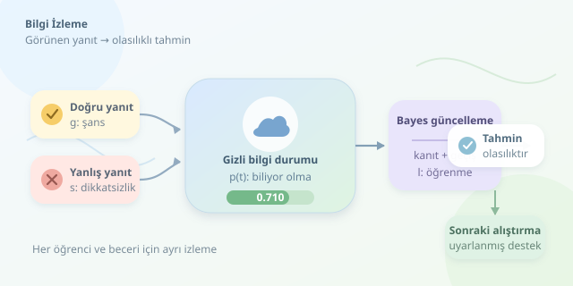

Bir öğrenci kesirlerle ilgili üç soruyu doğru çözdüğünde konuyu gerçekten öğrenmiş midir, yoksa seçeneklerle şanslı bir karşılaşma mı yaşamıştır? Akıllı öğretim sistemleri bu soruya yalnızca puan toplayarak cevap vermez. **Bilgi izleme**, öğrencinin yanıtlarından hareketle öğrenme durumunu zaman içinde tahmin eder. Bir bakıma öğretmenin sezgilerine olasılık hesap makinesi ekler; fakat zihin okuduğunu asla iddia etmez.



``

## Görünen cevap, görünmeyen bilgi

Bilgi izlemenin temelinde iki farklı değişken bulunur: gözlemlediğimiz cevap ve doğrudan göremediğimiz bilgi durumu. Öğrenci biliyorken dikkatsizlik yapabilir; bilmiyorken doğru seçeneği işaretleyebilir. Bu nedenle **doğru cevap ile öğrenme aynı şey değildir**.

Sistem, her etkileşimden sonra bir beceriye ilişkin inancını günceller. Buradaki beceri, “matematik” kadar geniş değil, “paydaları eşitleme” gibi ölçülebilir bir kazanım olmalıdır. Soruların yanlış becerilerle etiketlenmesi, en gelişmiş modelin bile pusulasını şaşırtır. Modelin takip ettiği şey, öğrencinin zihninin kusursuz bir kopyası değil, veriye dayalı bir tahmindir.

## Bayesçi Bilgi İzleme: Dört parametreli başlangıç

**Bayesian Knowledge Tracing**, kısaca BKT, klasik biçiminde öğrencinin bir beceriyi bildiğini veya henüz bilmediğini varsayar. Durum gizlidir; yanıtlar ise gözlemlenebilir. Böylece gizli Markov modeli yaklaşımıyla çalışır.

| Parametre | Anlamı | Örnek değer |
|---|---|---|
| $p_0$ | Başlangıçta biliyor olma olasılığı | 0.30 |
| $l$ | Etkileşim sonrasında öğrenme olasılığı | 0.15 |
| $g$ | Bilmiyorken doğru yanıtlama olasılığı | 0.20 |
| $s$ | Biliyorken yanlış yanıtlama olasılığı | 0.10 |

Unutmanın ihmal edildiği bu sürümde, önce yanıtın sağladığı kanıt değerlendirilir; ardından öğrenme geçişi uygulanır. Parametreler gerçek uygulamalarda geçmiş etkileşimlerden tahmin edilir. Tablodaki değerler yalnızca örnektir.

## Bir cevabın matematiksel yolculuğu

Yanıt öncesindeki bilgi olasılığı $p_t$ olsun. Doğru cevaptan sonraki ara tahmin Bayes kuralıyla hesaplanır:

$$p_t^{+}=\frac{p_t(1-s)}{p_t(1-s)+(1-p_t)g}$$

Pay, öğrencinin hem biliyor hem doğru cevaplıyor olmasını temsil eder. Payda ise doğru cevabın bütün olası yollarını toplar. Yanlış cevapta aynı mantık şöyle işler:

$$p_t^{+}=\frac{p_t s}{p_t s+(1-p_t)(1-g)}$$

Sonra, henüz bilmeyen öğrencinin bu etkileşim sırasında öğrenebileceği hesaba katılır:

$$p_{t+1}=p_t^{+}+(1-p_t^{+})l$$

Örnekteki değerlerle ilk doğru cevap, bilgi tahminini yaklaşık $0.659$ yapar. Öğrenme geçişinden sonra sonuç $0.710$ olur. Ancak bu, sonraki sorunun doğru yanıtlanma olasılığı değildir; o olasılık $p_{t+1}(1-s)+(1-p_{t+1})g$ ile bulunur. İki olasılığı karıştırmak, sistemin özgüvenini gereksiz yere şişirir.

## Python ile küçük bir izleyici

Aşağıdaki fonksiyon iki yanıt türünü ortak bir güncelleme akışında birleştirir. Olasılıkları doğrular, imkânsız gözlemleri yakalar ve sonraki etkileşim için kullanılacak bilgi tahminini döndürür.

```python
def update(p, correct, learn=0.15, guess=0.20, slip=0.10):
    if any(not 0 <= x <= 1 for x in (p, learn, guess, slip)):
        raise ValueError("Olasılıklar [0, 1] aralığında olmalı.")

    known_likelihood = 1 - slip if correct else slip
    unknown_likelihood = guess if correct else 1 - guess
    evidence = p * known_likelihood + (1 - p) * unknown_likelihood

    if evidence == 0:
        raise ValueError("Bu gözlem mevcut modelde imkânsız.")

    posterior = p * known_likelihood / evidence
    return posterior + (1 - posterior) * learn

p = 0.30
for correct in (True, False):
    p = update(p, correct)
    print(f"{p:.3f}")
```

Çıktılar sırasıyla yaklaşık `0.710` ve `0.349` olur. Tek yanlışın tahmini belirgin düşürmesi, seçilen parametrelerin sonucudur; öğrencinin gerçekten unuttuğunun kanıtı değildir. Gerçek sistemde her öğrenci–beceri çifti için ayrı durum tutulur. Birden fazla beceri gerektiren sorular ise ek modelleme ister.

## BKT tek seçenek mi?

| Yaklaşım | Temel fikir | Başlıca ödünleşim |
|---|---|---|
| BKT | Açık parametrelerle gizli bilgi durumu | Yorumlanabilir, fakat varsayımları sınırlı |
| DKT | Sinir ağlarıyla etkileşim dizileri | Esnek, fakat açıklaması daha zor |
| Dikkat tabanlı modeller | İlgili geçmiş etkileşimlere odaklanma | Karmaşık ilişkiler, daha fazla hesaplama |

Daha karmaşık model otomatik olarak daha iyi öğretmen değildir. Veri miktarı, beceri etiketleri ve değerlendirme düzeni sonucu belirler.

## Başarıyı nasıl ölçeriz?

Değerlendirmede gelecek yanıtların eğitim verisine sızmasını engellemek gerekir. AUC ayırt etme gücünü, log-loss olasılıksal tahmin kalitesini ölçer; kalibrasyon ise “yüzde 80” denilen durumların gerçekten buna yakın gerçekleşip gerçekleşmediğini sorgular.

Son hedef yalnızca doğru tahmin değil, daha etkili öğrenmedir. Önerilen alıştırmaların kazanımları artırdığı ayrıca sınanmalıdır. Öğrenci verileri korunmalı, düşük tahminler kalıcı etiketlere dönüşmemelidir. İyi bir sistem “Sen bunu bilmiyorsun” demez; “Burada biraz daha çalışmak faydalı olabilir” der.
