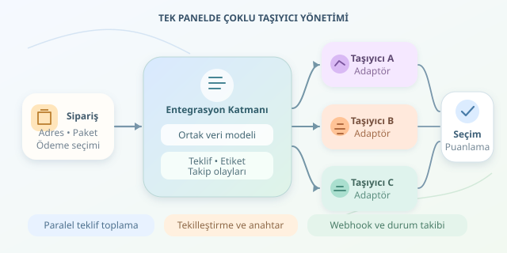

Müşteri siparişini verir; perde arkasında fiyat hesaplama, etiket oluşturma ve teslimat takibi başlar. Peki şirketiniz beş farklı kargo firmasıyla çalışıyorsa? Her firmanın paneline ayrı ayrı girmek yerine, hepsini tek sistemde buluşturabilirsiniz. İşin sırrı, API çağrılarından önce doğru soyutlamayı kurmaktır: Kargolar farklı diller konuşur, sizin sisteminiz tercüman olur.

``

## Temel fikir: Ortak model, farklı adaptörler

Çoklu taşıyıcı yönetimi, sipariş uygulamasıyla kargo servisleri arasına yerleşen bir entegrasyon katmanıdır. Bu katman adres, paket, ücret ve takip olaylarını ortak bir veri modeline dönüştürür. Böylece sipariş servisi, taşıyıcının XML mi JSON mı kullandığını bilmez.

Her firma için bir **adaptör** yazılır. Adaptör; kimlik doğrulamayı, alan dönüşümlerini, hata kodlarını ve taşıyıcıya özgü kuralları kapsüller. Yeni firma eklemek, bütün uygulamayı değiştirmek yerine yeni adaptör geliştirmek anlamına gelir.

| Yaklaşım | Doğrudan entegrasyon | Adaptör katmanı |
|---|---|---|
| Yeni taşıyıcı | Birçok modül değişebilir | Yeni adaptör eklenir |
| Durum kodları | Uygulamaya dağılır | Merkezde eşlenir |
| Test yaklaşımı | Firma detaylarına bağımlıdır | Ortak sözleşmelerle sınanır |

Ortak modelde ağırlık birimini, para birimini ve adres alanlarını açıkça tanımlayın. Bir adaptörün gramı kilogram sanması, yazılım hatasını oldukça pahalı bir fizik deneyine dönüştürebilir. Ücretleri ikili kayan nokta yerine `Decimal` gibi ondalık türlerle saklayın.

## En ucuz her zaman en iyi değildir

Taşıyıcı seçimi önce uygunluk filtresiyle başlar: Teslimat bölgesi, paket boyutu, kapıda ödeme ve ürün kısıtları kontrol edilir. Uygun olmayan firmayı puanlamak, bisikleti okyanus taşımacılığına aday göstermeye benzer.

Kalan seçenekler için örnek bir maliyet fonksiyonu kullanılabilir:

$$S_i = 0.6(P_i/200) + 0.3(D_i/5) + 0.1(1-R_i)$$

Burada $P_i$ aynı para birimindeki toplam ücret, $D_i$ tahmini teslimat günü, $R_i$ ise ilgili bölgedeki geçmiş teslimat başarı oranıdır. Düşük puan tercih edilir. Bölümler referans ölçekleridir; 200 TL ve beş gün evrensel sabitler değildir. Ağırlıkları işletmenizin öncelikleriyle doğrulayın.

## Python ile paralel teklif toplama

Aşağıdaki örnek, uygunluğu önceden kontrol edilmiş taşıyıcılardan eşzamanlı teklif toplar. Her adaptör, kendi API yanıtını ortak `Quote` nesnesine dönüştürür; firma uç noktaları özellikle adaptörün içinde kalır.

```python
import asyncio
from dataclasses import dataclass
from decimal import Decimal
from typing import Protocol

@dataclass(frozen=True)
class Quote:
    carrier: str
    price: Decimal
    days: int
    success_rate: float

class Carrier(Protocol):
    async def quote(self, shipment: dict) -> Quote: ...

async def choose(carriers: list[Carrier], shipment: dict) -> Quote:
    results = await asyncio.gather(
        *(asyncio.wait_for(c.quote(shipment), timeout=3)
          for c in carriers),
        return_exceptions=True,
    )
    offers = [r for r in results if isinstance(r, Quote)]
    if not offers:
        raise RuntimeError('Kullanılabilir teklif bulunamadı')

    def score(q: Quote) -> float:
        return (0.6 * float(q.price) / 200
                + 0.3 * q.days / 5
                + 0.1 * (1 - q.success_rate))

    return min(offers, key=score)
```

`gather`, bir firmanın hatasının diğer teklifleri kaybettirmesini önler. Üç saniyelik sınır kullanıcı bekleyişini kontrol eder. Buradaki `float` dönüşümü yalnızca sıralama içindir; tahsilat hesabında kullanılmaz. Üretimde başarısız çağrıları ayrıca kaydedin, teklif geçerlilik süresini ve ek ücretleri doğrulayın. Başarı oranı tahmindir, teslimat garantisi değildir.

## Gönderi oluşturmak: Tekrar denemek masum olmayabilir

Teklif sorgusunu yinelemekle gönderi oluşturmayı yinelemek aynı şey değildir. Oluşturma isteği zaman aşımına uğrasa bile taşıyıcı gönderiyi açmış olabilir. Körlemesine tekrar denemek çift etiket ve çift ücret doğurabilir.

Her gönderi için kalıcı bir işlem anahtarı üretin. Taşıyıcı destekliyorsa bunu idempotency anahtarı olarak iletin; desteklemiyorsa müşteri referansıyla sorgulama ve mutabakat uygulayın. Yerel benzersizlik kısıtı tek başına uzaktaki tekrarları engellemez. Sipariş kaydıyla gönderim işini güvenilir bağlamak için transactional outbox kullanabilirsiniz.

## Takip olayları ve operasyon

Webhook bildirimleri geç, yinelenmiş veya sırasız gelebilir. İmzayı sağlayıcının tarif ettiği biçimde ham gövde üzerinden doğrulayın; zaman damgasını ve tekrar oynatma riskini kontrol edin. Olayı kalıcılaştırdıktan sonra hızlıca yanıtlayıp işlemi kuyruğa bırakın.

| Gelen olay | Sistemin davranışı |
|---|---|
| Aynı olay yeniden geldi | Tekilleştir |
| Eski olay sonradan geldi | Durumu geriye düşürme |
| Bilinmeyen durum geldi | Kaydet, incelemeye yönlendir |

Son olarak teklif gecikmesini, etiket oluşturma hatalarını ve teslimat başarısını taşıyıcı bazında izleyin. API anahtarlarını gizli bilgi kasasında tutun; adresleri loglara dökmeyin. Başarılı mimari, bütün firmaları aynılaştırmaz: Farklılıklarını kontrollü biçimde yönetir.
