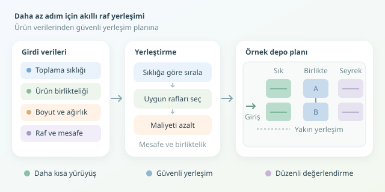

Bir depoda çalışanların gün boyunca attığı adımları düşünün: Bazen en çok satan ürün, çıkış kapısından en uzak rafta sessizce bekler. Sonuç, fazladan yürüyüş ve geciken siparişlerdir. Depo yerleşim optimizasyonu, ürünleri rastgele boşluklara koymak yerine talep, mesafe ve fiziksel kısıtları birlikte değerlendirir. Amaç, depoyu dev bir saklambaç oyunundan kurtarmaktır.

``

## Önce problemi doğru modelleyelim

Raf yerleştirme, yani *slotting*, hangi ürünün hangi konumda tutulacağını belirler. Sipariş toplama rotası ise çalışanların bu konumları hangi sırayla ziyaret edeceğini çözer. Birbirlerini etkileseler de bunlar aynı problem değildir: Harika bir rota, kötü yerleşimin bütün zararını silemez.

Başlangıç için ürünlerin toplama sıklığı, boyutları, stok ağırlığı ve birlikte sipariş edilme sayıları gerekir. Rafların kapasitesi, erişilebilirliği ve başlangıç noktasına uzaklığı da kaydedilir. Burada satış cirosundan çok **toplama ziyaret sıklığı** önemlidir; pahalı ama nadiren alınan bir ürün, kapının önünü hak etmeyebilir.

Basitleştirilmiş bir amaç fonksiyonu şöyle kurulabilir:

$$J=\sum_i f_i\frac{2d(0,x_i)}{v}+\lambda\sum_{i<j}c_{ij}\frac{d(x_i,x_j)}{v}$$

Burada $f_i$ toplama sıklığı, $x_i$ ürünün konumu, $v$ yürüme hızı ve $c_{ij}$ birlikte sipariş edilme sayısıdır. İlk terim girişe yakınlığı, ikinci terim ilişkili ürünlerin yakınlığını ödüllendirir. $\lambda$ bu iki tercihin dengesini ayarlar. Bu ifade gerçek sipariş rotalarının süresini birebir vermez; yerleşimleri karşılaştırmak için kullanılan bir yaklaşımdır.

## Hangi yaklaşım, hangi durumda?

| Yaklaşım | Temel fikir | Güçlü yön | Zayıf yön |
|---|---|---|---|
| Rastgele yerleşim | Uygun boş rafa koy | Basit başlangıç | Uzun yürüyüşler |
| ABC yerleşimi | Sık toplananı yakına al | Kolay uygulanır | Ürün ilişkilerini kaçırır |
| Birliktelik odaklı | Birlikte alınanları yakınlaştır | Çok ürünlü siparişlere uygun | Talep değişimine duyarlı |
| Yerel arama | Ürün konumlarını takas et | Mevcut planı iyileştirir | Yerel optimuma takılabilir |




ABC sınıflandırması iyi bir başlangıçtır; ancak bütün popüler ürünleri aynı koridora yığmak trafik yaratabilir. Ağır ürünlerin güvenli yükseklikte tutulması ve uyumsuz ürünlerin ayrılması, hız uğruna esnetilecek tercihler değil, zorunlu kısıtlardır.

## Python ile açgözlü yerleştirme

Aşağıdaki algoritma, sık toplanan ürünlerden başlayarak uygun raflar arasından en düşük ek maliyetliyi seçer. Her raf tek bir ürün türüne ayrılır; ürünün o konumda tutulacak toplam stok ağırlığının kapasiteye sığdığı varsayılır.

```python
def yerlestir(urunler, raflar, beraberlik, hiz=60, katsayi=0.4):
    def mesafe(a, b):
        return abs(a[0] - b[0]) + abs(a[1] - b[1])

    bos = list(raflar)
    plan = {}
    for urun in sorted(urunler, key=lambda u: -u['siklik']):
        uygun = [r for r in bos
                 if r['kapasite'] >= urun['stok_kg']
                 and r['yukseklik'] >= urun['boy_cm']]
        if not uygun:
            raise ValueError(f"Uygun raf bulunamadi: {urun['id']}")

        def maliyet(raf):
            temel = urun['siklik'] * 2 * mesafe((0, 0), raf['xy']) / hiz
            iliski = sum(
                beraberlik.get(frozenset((urun['id'], kod)), 0)
                * mesafe(raf['xy'], diger['xy']) / hiz
                for kod, diger in plan.items()
            )
            return temel + katsayi * iliski

        secilen = min(uygun, key=maliyet)
        plan[urun['id']] = secilen
        bos.remove(secilen)
    return plan
```

Girdiler sözlük listeleridir: Ürünlerde `id`, `siklik`, `stok_kg`, `boy_cm`; raflarda `xy`, `kapasite`, `yukseklik` bulunur. `beraberlik`, ürün çiftlerini `frozenset` anahtarlarıyla sipariş sayılarına bağlar. Koordinatlar metre, hız metre/dakika olarak alınır. Mesafe hesabı engelsiz dik açılı geçişleri varsayar; gerçek depoda rafların içinden yürünemeyeceği için koridor grafındaki en kısa yol kullanılmalıdır.

Açgözlü yöntem hızlıdır, fakat erken kararlarını geri almaz. Uygun raf bulamaması, geçerli hiçbir yerleşim olmadığı anlamına gelmez. İyileştirme aşamasında iki ürünün yerini takas edip kısıtlar sağlanıyorsa toplam maliyeti yeniden hesaplayabilirsiniz.

## Başarıyı yürüyüşle ölçün

Yeni planı aynı geçmiş siparişler ve aynı rota yöntemiyle karşılaştırın. Ortalama toplama süresinin yanında yüzde 95'lik dilimi, koridor yoğunluğunu ve raf yenileme iş yükünü izleyin. Yer değiştirme maliyetini de hesaba katın: Her gün raf taşımak, kazanılan zamanı geri yiyebilir.

Son olarak küçük bir bölgede pilot uygulama yapın. Mevsimsellik ve kampanyalar ürünlerin önemini değiştireceğinden yerleşimi düzenli aralıklarla yeniden değerlendirin. En iyi depo, matematiksel olarak şık görünen değil; çalışanların güvenle, daha az adımla sipariş tamamladığı depodur.
