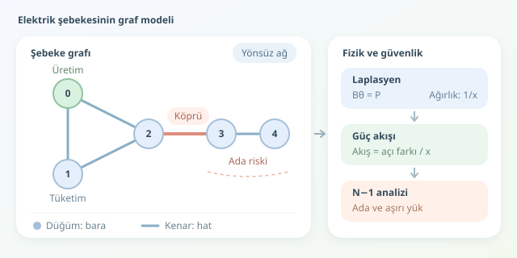

Bir elektrik şebekesini dev bir yol ağı gibi düşünün: Kavşaklar baralar, yollar iletim hatları, trafik ise güç akışıdır. Ancak elektriğin navigasyon uygulaması yoktur; hangi yoldan gideceğini fizik yasaları belirler. Graf teorisi, bu karmaşık ağı anlaşılır bir matematiksel modele dönüştürerek darboğazları, kritik bağlantıları ve arızaların olası etkilerini keşfetmemizi sağlar.

``

## Şebekeyi Düğüm ve Kenarlara Dönüştürmek

Bir şebekeyi $G=(V,E)$ grafıyla gösteririz. Burada $V$, üretim veya tüketimin bağlandığı baraları; $E$ ise hatları ve uygun modellerle transformatörleri temsil eder. Üretim ve tüketim değerleri düğümlere, reaktans ve kapasite gibi özellikler kenarlara atanır.

Başlangıç için yönsüz graf uygundur: Bir hattaki güç, işletme koşullarına göre iki yönde de akabilir. Hesaplamada seçilen yön yalnızca işaret uzlaşımıdır. Aynı iki bara arasında birden fazla hat varsa, bunları ayrı tutmak için çoklu graf kullanmak gerekir.

| Graf öğesi | Şebekedeki karşılığı | Analizdeki rolü |
|---|---|---|
| Düğüm | Bara | Güç dengesi |
| Kenar | İletim hattı | Elektriksel bağlantı |
| Kenar ağırlığı | Reaktansın tersi | Akışın paylaşılması |
| Bağlı bileşen | Elektriksel ada | Ayrışma tespiti |

Buradaki kritik ayrım şudur: Bir grafın bağlı olması, şebekenin güvenli işletilebildiği anlamına gelmez. Bağlantı vardır ama hat kapasitesi yetersiz olabilir!

## Topolojiden Güç Akışına: Laplasyen

Sadece bağlantıları saymak yerine elektriksel özellikleri de hesaba katalım. Basitleştirilmiş DC güç akışı yaklaşımında gerilim büyüklükleri yaklaşık sabit, açı farkları küçük ve hat dirençleri reaktanslara göre ihmal edilebilir kabul edilir. Kayıplar da modellenmez. Buradaki “DC”, doğru akımlı şebeke değil, AC şebekenin doğrusal yaklaşımıdır.

Hat reaktansı $x_{ij}$ için ağırlık $b_{ij}=1/x_{ij}$ alınır. Bu ağırlıklarla oluşturulan Laplasyen matrisi $B$, güç enjeksiyonlarıyla gerilim açılarını ilişkilendirir:

$$B\theta=P$$

Pozitif $P$ net üretimi, negatif $P$ net tüketimi gösterir. Hat akışı ise:

$$f_{ij}=\frac{\theta_i-\theta_j}{x_{ij}}$$

Bağlı bir şebekede bütün açılara aynı sabiti eklemek akışları değiştirmez. Bu nedenle $B$ tekildir; bir referans barasının açısını sıfıra sabitleyip indirgenmiş sistemi çözeriz. Ayrıca toplam enjeksiyon sıfır olmalıdır. Elektrik muhasebesinde açık bırakılamaz!

## Python ile Küçük Bir Deney

Aşağıdaki örnek için `pip install networkx numpy` yeterlidir. Beş baralı ağda reaktansları ortak birim sisteminde, güçleri ise aynı bazdaki per-unit değerlerle tanımlıyoruz. Sıfır numaralı bara referanstır; diğer baralar tüketicidir. Örnek, bağlantı bilgisi ile fiziksel hesabı aynı veri yapısında buluşturur.

```python
import networkx as nx
import numpy as np

G = nx.Graph()
lines = [(0, 1, 0.10), (1, 2, 0.15),
         (2, 0, 0.20), (2, 3, 0.10),
         (3, 4, 0.12)]
for u, v, x in lines:
    G.add_edge(u, v, x=x, b=1/x, limit=0.8)

nodes = list(range(5))
P = np.array([1.0, -0.3, -0.2, -0.1, -0.4])
if not nx.is_connected(G) or not np.isclose(P.sum(), 0):
    raise ValueError('Bağlılık ve güç dengesi gerekli.')

W = nx.to_numpy_array(G, nodelist=nodes, weight='b')
B = np.diag(W.sum(axis=1)) - W
theta = np.zeros(len(nodes))
theta[1:] = np.linalg.solve(B[1:, 1:], P[1:])

for u, v, data in G.edges(data=True):
    flow = (theta[u] - theta[v]) / data['x']
    overloaded = abs(flow) > data['limit']
    print(u, v, round(flow, 3), overloaded)

print('Köprüler:', list(nx.bridges(G)))
```

`W` ağırlıklı komşuluk matrisidir; satır toplamlarından oluşturulan köşegen sayesinde Laplasyen elde edilir. İndirgenmiş sistem açıları, son döngü ise hat akışlarını hesaplar. Negatif sonuç ters yöndeki akışı belirtir. Kapasite karşılaştırması burada aktif güç içindir; gerçek işletmede akım ve görünür güç sınırları da önemlidir.

## Bir Hat Koparsa Ne Olur?

Graf teorisindeki köprü, çıkarıldığında ağı bölen kenardır. Örnekte `(2, 3)` hattı köprüdür. Devreden çıkması, 3 ve 4 numaralı baraları ayrı bir adaya dönüştürür. Bu adada üretim bulunmadığından mevcut tüketim sürdürülemez.

| Analiz | Yanıtladığı soru | Tek başına yeterli mi? |
|---|---|---|
| Bağlılık | Baralar birbirine ulaşabiliyor mu? | Hayır |
| Köprü tespiti | Tek hat kaybı adalaşma yaratır mı? | Hayır |
| DC akış | Aktif güç nereden geçiyor? | Yaklaşık olarak |
| AC akış | Gerilim ve reaktif güç uygun mu? | Statik değerlendirme için |

N−1 incelemesinde her hat sırayla kaldırılır. Önce adalar bulunur, ardından uygun dengeleme varsayımlarıyla akış yeniden hesaplanır. Köprü olmayan bir hattın kaybı da kalan hatları aşırı yükleyebilir. Dolayısıyla “ağ bölünmedi” demek, “sorun yok” demek değildir.

## Modeli Büyütürken

Büyük şebekelerde seyrek matrisler bellek ve süre kazandırır. Bunun yanında en kısa yol veya merkezilik ölçümleri yararlı önceliklendirme araçlarıdır; fiziksel akışın yerine geçmezler. Elektrik tek bir kısa yolu seçmez, ağın empedanslarına göre dağılır. Son olarak, statik graf analizi frekans kararlılığını ya da koruma davranışını açıklamaz: Bunlar için dinamik modeller gerekir. Graf teorisi güçlü bir haritadır; fakat haritanın kendisi bütün arazi değildir.
