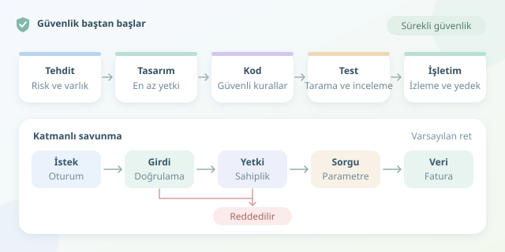

Bir uygulamanın güvenliğini yayına çıkmadan önce yapılan son kontrole bırakmak, evi bitirdikten sonra temeline bakmaya benzer. Güvenli kod geliştirme, yalnızca saldırıları engelleyen birkaç koşul yazmak değildir; gereksinimlerden mimariye, kod incelemesinden dağıtıma kadar uzanan bir düşünme biçimidir. İyi haber: Bu yaklaşım, doğru alışkanlıklarla günlük geliştirme akışına yerleşebilir.

``

## Önce saldırganın gözlüğünü takın

Güvenlik çalışmasının başlangıcı araç seçmek değil, neyi koruduğunuzu anlamaktır. Kullanıcı verileri, erişim anahtarları ve ödeme kayıtları birer varlıktır. İnternetten gelen isteklerin uygulamaya, uygulamanın veritabanına geçtiği noktalar ise farklı güven sınırları oluşturabilir.

Basit bir önceliklendirme modeli şöyle yazılabilir: $R \approx P(A) \times E(A)$. Burada $P(A)$ saldırı senaryosunun gerçekleşme olasılığını, $E(A)$ gerçekleşirse doğuracağı etkiyi temsil eder. Bu ifade kesin bir ölçüm değil, tartışmayı yapılandıran bir yardımcıdır.

Her özellik için sorun: Kim kötüye kullanabilir? Hangi veriye ulaşabilir? Hangi kontrol bunu önler? Örneğin fatura görüntüleme özelliğinde temel tehdit, kullanıcının başka bir müşterinin faturasını istemesidir.

## Güvenliği tasarım kararı yapın

**Varsayılan olarak reddetmek**, açıkça izin verilmeyen işlemleri engellemektir. **En az ayrıcalık**, kullanıcıya ve servise yalnızca ihtiyaç duyduğu yetkiyi vermektir. Böylece tek bir hatanın etki alanı küçülür.

| Karar alanı | Riskli yaklaşım | Güvenli başlangıç |
|---|---|---|
| Yetkilendirme | Düğmeyi arayüzde gizlemek | Her istekte sunucuda denetlemek |
| Veritabanı | Sorguyu metin birleştirerek kurmak | Parametreli sorgu kullanmak |
| Erişim anahtarları | Anahtarları kaynak koda yazmak | Merkezi sır yönetimi kullanmak |
| Hata mesajları | Yığın izini kullanıcıya göstermek | Genel mesaj ve kontrollü günlükleme |

Kimlik doğrulama, kullanıcının kim olduğunu söyler; yetkilendirme ise hangi kaynağa erişebileceğini belirler. Oturum açmış olmak, bütün kapıları açan sihirli bir kart değildir. Ayrıca girdinin biçimsel olarak geçerli olması, o girdinin işaret ettiği kaynağa erişimin meşru olduğu anlamına gelmez.

## Kodda iki ayrı savunmayı birlikte kurun

Aşağıdaki Python örneği, SQLite üzerinde fatura okur. `authenticated_user_id` değerinin istemciden değil, sunucunun doğruladığı oturumdan geldiği varsayılır. Kod hem kimlik biçimini sınırlar hem de sorguyu kaynak sahibine bağlar.

```python
import sqlite3


def get_invoice(
    db: sqlite3.Connection,
    authenticated_user_id: int,
    invoice_id: str,
):
    try:
        record_id = int(invoice_id)
    except ValueError:
        raise ValueError("Geçersiz fatura kimliği.") from None

    if not 1 <= record_id <= 2**63 - 1:
        raise ValueError("Geçersiz fatura kimliği.")

    row = db.execute(
        "SELECT id, total_kurus FROM invoices "
        "WHERE id = ? AND owner_id = ?",
        (record_id, authenticated_user_id),
    ).fetchone()

    if row is None:
        raise LookupError("Kayıt bulunamadı.")
    return row
```

Parametreli sorgu, kullanıcı verisinin SQL komutunun parçası olarak yorumlanmasını önler. `owner_id` koşulu ise başka kullanıcıların kayıtlarına erişimi engeller. Bunlar farklı tehditlere karşı çalışan, birbirinin yerine geçmeyen kontrollerdir.

Pozitif ve 64 bit aralığında kimlik kontrolü, veritabanının beklediği değer alanını korur. HTTP katmanı bu örnekteki doğrulama hatalarını uygun istemci yanıtlarına dönüştürmeli, beklenmeyen hatalarda iç ayrıntıları gizlemelidir. Bulunamayan ve erişilemeyen kayıtlar için aynı dış yanıtı kullanmak, kayıtların varlığı hakkında gereksiz ipucu vermemeye yardımcı olur.

## Güvenlik kontrollerini geliştirme hattına yerleştirin

Güvenlik incelemesi yalnızca uzman ekibin takviminde bekleyen bir toplantı olmamalıdır. Çekme isteği şablonuna veri sınıflandırması, yetki kontrolü ve hassas günlükleme soruları ekleyin. Büyük değişiklikleri küçük parçalara bölmek, inceleyenin kritik davranışları fark etmesini kolaylaştırır.

- **Birim testleri:** Geçersiz kimlikleri, sınır değerlerini ve reddedilen işlemleri doğrulayın.
- **Entegrasyon testleri:** İki farklı kullanıcı oluşturup birinin diğerinin faturasını okuyamadığını sınayın.
- **Statik analiz:** Riskli kod kalıplarını erken yakalayın; bulguları bağlamıyla değerlendirin.
- **Bağımlılık taraması:** Bilinen açıkları izleyin, düzeltmeleri test ederek uygulayın.
- **Sır taraması:** Erişim anahtarlarının depoya girmesini engelleyin; sızıntıda anahtarı yenileyin.

Araçların yeşil ışık yakması, uygulamanın tamamen güvenli olduğunu kanıtlamaz. Özellikle iş mantığı hataları, insan incelemesi ve kötüye kullanım senaryoları gerektirir.

## Üretimde de savunmayı sürdürün

TLS kullanın, üretim hesaplarının yetkilerini daraltın ve hassas işlemlere uygun hız sınırlaması uygulayın. Günlüklere parola, oturum belirteci veya gereksiz kişisel veri yazmayın. Güvenlik olaylarını araştırmaya yetecek bağlamı, erişimi kısıtlanmış kayıtlarda tutun.

Son olarak bağımlılık güncellemeleri, olay müdahalesi ve yedekten dönüş için sorumlular belirleyin. Yedek almak kadar geri yüklemeyi denemek de önemlidir. Güvenlik, kapıya asılan bir kilit değil; tasarımdan işletime kadar çalışan bir alışkanlıklar sistemidir.
