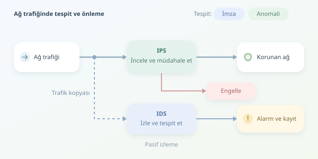

Bir sunucunun gece üçte binlerce bağlantı başlatması güncelleme işleminden de kaynaklanabilir, ele geçirilmiş olmasından da. Ağ güvenliğinin eğlenceli ve zor tarafı burada başlar: Hareketi görmek yetmez, anlamlandırmak gerekir. IDS ve IPS, bu dijital mahallede şüpheli davranışları araştıran iki farklı güvenlik rolünü üstlenir.

``

## IDS izler, IPS müdahale eder

**IDS**, yani Saldırı Tespit Sistemi, trafiği inceleyerek şüpheli olaylar için alarm üretir. Genellikle ağın kopyalanmış trafiğini dinler. **IPS**, yani Saldırı Önleme Sistemi ise çoğunlukla trafik yoluna yerleşir; kurallara göre paket düşürebilir veya bağlantıyı engelleyebilir.

| Özellik | IDS | IPS |
|---|---|---|
| Tipik konum | Trafiğin kopyasında | Trafik yolunda |
| Temel çıktı | Alarm ve kayıt | Alarm ve engelleme |
| Yanlış kararın etkisi | Analist yükü | Meşru hizmetin kesilmesi |

Kısacası dedektifin yanılması zaman kaybettirir; kapıdaki görevlinin yanılması müşteriyi dışarıda bırakabilir. Bu yüzden aynı tespit kuralı, IDS ve IPS üzerinde farklı operasyonel sonuçlar doğurur.

## İmza tabanlı tespit: Tanıdık izleri aramak

İmza, bilinen bir saldırıyla ilişkilendirilmiş örüntüdür. Belirli bayt dizileri, protokol alanları veya bağlantı davranışları eşleştirilebilir. Ancak iyi bir imza yalnızca kelime aramaz; yön, oturum durumu ve protokol bağlamını da değerlendirir.

Aşağıdaki Suricata kuralı, laboratuvarda belirli bir HTTP yolunu ziyaret ettiğinizde alarm üretir. **Gerçek saldırı imzası değildir**; eşleştirme mantığını güvenli biçimde gösterir:

```suricata
alert http any any -> $HOME_NET any (msg:"LAB test URI"; flow:established,to_server; http.uri; content:"/ids-lab-test"; sid:1000001; rev:1;)
```

Burada `$HOME_NET`, yapılandırmada tanımlanan korunan ağı temsil eder. `http.uri`, aramayı HTTP URI alanına sınırlar; `flow` ise kurulmuş bağlantıda sunucuya giden yönü seçer. `sid`, kuralın kimliğidir. Üretimde yalnızca bir metin parçasına dayanmak yerine bağlamı daraltmak, yanlış alarmları azaltır.

İmzalar bilinen tehditlerde açıklanabilir sonuçlar verir. Buna karşılık yeni saldırılar, farklı kodlamalar ve görünürlük eksikliği eşleştirmeyi boşa çıkarabilir. Şifreli HTTP içeriği de uygun çözümleme olmadan bu şekilde incelenemez.

## Anomali tabanlı tespit: Normalden sapmayı ölçmek

Anomali yaklaşımı önce normal davranışın profilini çıkarır. Dakikadaki bağlantı sayısı, hedef çeşitliliği veya gönderilen veri miktarı bu profilin özellikleri olabilir. Ardından yeni gözlemin geçmişten ne kadar uzaklaştığı ölçülür.

Basit bir yöntem, standartlaştırılmış uzaklıktır:

$$z = \frac{x-\mu}{\sigma}$$

Burada $x$ yeni ölçüm, $\mu$ geçmiş ortalama, $\sigma$ standart sapmadır. Aşağıdaki Python örneği, aynı kaynak için dakikalık bağlantı sayılarını değerlendirir:

```python
from statistics import mean, pstdev

# Ayrı bir eğitim döneminden, temiz kabul edilen ölçümler.
baseline = [90, 100, 95, 105, 110, 98, 102, 97, 103, 100]
mu = mean(baseline)
sigma = max(pstdev(baseline), 1.0)

def evaluate(connections):
    z = (connections - mu) / sigma
    return {"z_score": round(z, 2), "alert": z > 3}

print(evaluate(180))
```

Kod, eğitim verisini mevcut gözlemden ayırır; standart sapmaya alt sınır koyarak sıfıra bölünmeyi önler. Ancak `3` evrensel güvenlik sabiti değildir. Trafik dağılımı, zaman bağımlılığı ve iş yükü nedeniyle eşik gerçek veride doğrulanmalıdır.

| Yaklaşım | Güçlü tarafı | Temel riski |
|---|---|---|
| İmza | Bilinen örüntüyü açıklamak | Yeni varyantı kaçırmak |
| Anomali | Bilinmeyen sapmayı yakalamak | Meşru değişimi saldırı sanmak |

## Alarmı karara dönüştürmek

Anomali, saldırı demek değildir. Yedekleme işleri ve kampanyalar da trafiği sıçratır. Bu yüzden profilleri sunucu rolü, saat ve ağ bölgesi bazında ayırmak gerekir. Zamanla değişen normale **kavram kayması** denir; kontrolsüz öğrenme ise saldırgan davranışını normalleştirebilir.

Başarıyı yalnızca alarm sayısıyla ölçmeyin. $Precision = TP/(TP+FP)$, alarmların ne kadarının doğru olduğunu; $Recall = TP/(TP+FN)$ ise gerçek saldırıların ne kadarının yakalandığını gösterir. Burada TP doğru alarm, FP yanlış alarm, FN kaçırılan saldırıdır.

Pratik başlangıç, kuralları önce izleme modunda çalıştırmak, alarmları doğrulamak ve yalnızca yüksek güvenli durumlarda engellemeye geçmektir. IPS için gecikme, kapasite ve arıza anında trafiğin geçirilmesi veya durdurulması kararı da planlanmalıdır. En iyi sonuç, imza ile anomaliyi yarıştırmak değil; ikisini varlık bilgisi ve analist değerlendirmesiyle birleştirmektir.



