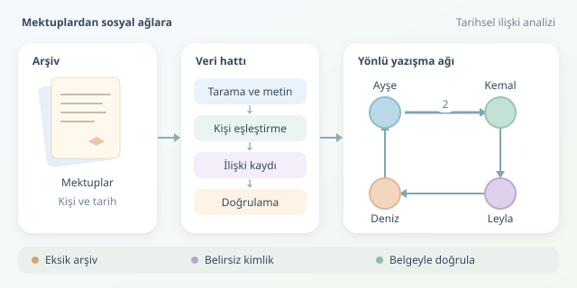

Bir arşivdeki yüzlerce mektup, ilk bakışta yalnızca kâğıt yığınları gibi görünebilir. Oysa gönderenleri, alıcıları ve tarihleri bir araya getirdiğinizde geçmişin sosyal dokusu belirginleşir: Kim haber taşıyordu, kim farklı çevreleri buluşturuyordu? Ağ analizi, bu ilişkileri araştırılabilir bir modele dönüştürür. Ancak renkli noktaların cazibesine kapılmadan önce, belgenin ne söylediğini dikkatle anlamamız gerekir.

``

## Önce ilişkiyi tanımlayalım

Graf teorisinde bir ağ, $G=(V,E)$ biçiminde gösterilir. Burada $V$ kişiler kümesini, $E$ ise aralarındaki ilişkileri temsil eder. Bir mektupta gönderen ile alıcı arasında bağlantı kurabilirsiniz; fakat aynı belgede adı geçen herkesin birbirini tanıdığını varsayamazsınız. Aynı sayfada görünmek, aynı masada oturmak değildir!

İlişkinin anlamı, grafın yapısını belirler. Yazışma genellikle yönlüdür: Ayşe’nin Kemal’e yazması, Kemal’in cevap verdiğini kanıtlamaz. Ortak kurum üyeliği ise yönsüz modellenebilir. Farklı ilişki türlerini tek çizgide eritmek yerine ayrı katmanlarda tutmak, tarihsel anlamı korur.

| Model | Bağlantının anlamı | Temel sınırlama |
|---|---|---|
| Yönlü ağ | Bir kişinin diğerine mektup göndermesi | Karşılıklılık varsayılamaz |
| Yönsüz ağ | Ortak dernek üyeliği | Yakın dostluk kanıtlanmaz |
| Ağırlıklı ağ | Belgelenen iletişim sıklığı | Arşiv kayıplarından etkilenir |
| Zamansal ağ | Belirli dönemdeki ilişkiler | Tarihlendirme belirsiz olabilir |

## Sayılar bize ne anlatır?

Derece merkeziliği, kişinin doğrudan bağlantılarını özetler. Yönlü ağlarda gelen ve giden bağlantılar ayrılır. Çok kişiye mektup gönderen biriyle çok kişiden mektup alan biri, aynı sosyal rolü üstlenmeyebilir.

Aradalık merkeziliği ise farklı kişiler arasındaki en kısa yollar üzerinde bulunmayı ölçer:

$$C_B(v)=\sum_{s\ne v\ne t}\frac{\sigma_{st}(v)}{\sigma_{st}}$$

Burada toplam, birbirinden farklı başlangıç ve hedef çiftleri üzerinde alınır. $\sigma_{st}$ en kısa yolların sayısı, $\sigma_{st}(v)$ ise bunlardan $v$ üzerinden geçenlerin sayısıdır. Yüksek değer, olası bir aracılık konumuna işaret eder; siyasi nüfuzun kesin kanıtı değildir.

Bağlantı ağırlığı mektup sayısıysa, güçlü ilişkiyi kısa mesafe olarak modellemek için $d_{ij}=1/w_{ij}$ kullanılabilir. Bu tercih bir varsayımdır: Yoğun yazışmanın iletişim maliyetini azalttığını kabul eder, gerçek mesafeyi ölçmez.

## Belgeleri küçük bir veri hattına sokalım

Pratik süreç; tarama, OCR, kişi adlarını çıkarma ve kimlik eşleştirme adımlarından oluşur. “A. Kemal”, “Kemal Bey” ve “Ahmed Kemal” aynı kişi olabilir; fakat otomatik birleştirme hatalı sonuçlar doğurabilir. Her ilişki kaydında belge kimliği, tarih, ilişki türü ve doğrulama durumu saklanmalıdır. Şüpheli eşleşmeler ayrıca işaretlenmeli, özgün görüntüyle denetlenmelidir.

Aşağıdaki tamamen kurgusal örnek, elle doğrulanmış kayıtları kullanır. Gerekli paketleri `pip install networkx matplotlib` komutuyla kurabilirsiniz.

```python
import networkx as nx
import matplotlib.pyplot as plt

kayitlar = [
    ("Ayşe", "Kemal", "1871-01-12", "K1"),
    ("Ayşe", "Kemal", "1871-02-03", "K2"),
    ("Kemal", "Leyla", "1871-03-08", "K3"),
    ("Leyla", "Deniz", "1871-04-17", "K4"),
    ("Deniz", "Ayşe", "1871-05-21", "K5"),
]

g = nx.DiGraph()
for kaynak, hedef, tarih, belge in kayitlar:
    if not g.has_edge(kaynak, hedef):
        g.add_edge(kaynak, hedef, weight=0,
                   belgeler=[], tarihler=[])
    veri = g[kaynak][hedef]
    veri["weight"] += 1
    veri["belgeler"].append(belge)
    veri["tarihler"].append(tarih)

for _, _, veri in g.edges(data=True):
    veri["distance"] = 1 / veri["weight"]

aradalik = nx.betweenness_centrality(g, weight="distance")
konum = nx.spring_layout(g, seed=42, weight="weight")
boyutlar = [700 + 3000 * aradalik[k] for k in g.nodes]

nx.draw_networkx(g, konum, node_size=boyutlar,
                 node_color="lightblue", arrows=True)
etiketler = nx.get_edge_attributes(g, "weight")
nx.draw_networkx_edge_labels(g, konum, edge_labels=etiketler)
plt.axis("off")
plt.show()
```

Kod, tekrarlanan yazışmaları tek bağlantıda toplar; belge ve tarih bilgilerini kaybetmez. Oklar iletişimin yönünü, kenar etiketleri mektup sayısını gösterir. Düğüm boyutu aradalığa bağlıdır. Sabit rastgelelik tohumu, yerleşimin tekrar üretilebilir olmasını sağlar. Ancak bu konumlar coğrafi koordinat değildir.

## Güzel grafik, sağlam tarih demek değildir

Eksik arşivler, bazı kişileri gerçekte olduklarından daha önemsiz gösterebilir. Üstelik belgeyi saklanan kişi ile toplumda etkili kişi her zaman aynı değildir. Bu nedenle farklı dönemleri ayrı inceleyin, belirsiz kayıtları çıkararak sonuçların değişip değişmediğini kontrol edin ve merkezilik sıralamalarını belgelerle karşılaştırın.

Topluluk tespiti de araştırma sorusu üretir; otomatik bulunan kümeler doğrudan siyasi hizip veya dost çevresi sayılamaz. En verimli yaklaşım, grafı bir hüküm makinesi değil, arşive geri dönmeyi sağlayan bir pusula olarak kullanmaktır. Geçmişi noktalar ve çizgilerle sadeleştiririz; insanların hikâyelerini ise o çizgilerin arkasındaki belgeler anlatır.



