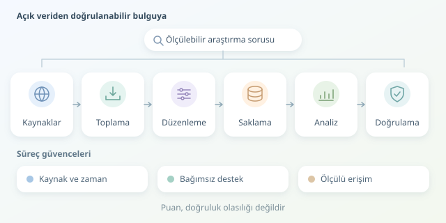

İnterneti dev bir kütüphane olarak düşünün: Bazı raflar düzenli, bazı kitapların kapağı yanlış, bazı bilgilerse yıllardır güncellenmemiş. Açık Kaynak İstihbaratı, yani OSINT, bu karmaşadan doğrulanabilir sonuçlar çıkarma disiplinidir. Yazılım burada büyüteç değil, yorulmadan çalışan bir araştırma asistanıdır. Ancak hızlı veri toplamakla doğru bilgi üretmek aynı şey değildir.

``

## Veriden istihbarata giden yol

Bir OSINT sistemi genellikle toplama, ayrıştırma, normalleştirme, saklama, analiz ve doğrulama aşamalarından oluşur. Ham veri yalnızca gözlemdir; bağlam ve karşılaştırma eklendiğinde anlam kazanır. Örneğin, bir yazılım projesindeki duyuru sayısının artması hareketlilik gösterebilir ama tek başına projenin daha güvenli olduğunu kanıtlamaz.

Bu nedenle araştırmaya soruyla başlanır: “Hangi projeler son ayda daha sık güvenlik duyurusu yayımladı?” gibi ölçülebilir bir soru, rastgele bağlantı biriktirmekten daha değerlidir. Ayrıca örnekleme yanlılığını düşünmeliyiz: Yalnızca RSS sunan projeleri izliyorsak bütün ekosistemi temsil etmiyoruz.

Kayıtları inceleme sırasına koymak için basit bir puan kullanılabilir:

$$S = 0.5G + 0.3T + 0.2B$$

Burada $G$ kaynak güvenilirliği, $T$ güncellik, $B$ bağımsız kaynaklarla desteklenme düzeyidir; hepsi 0–1 aralığındadır. Katsayılar örnektir. **Bu puan doğruluk olasılığı değildir:** Aynı haberin kopyaları bağımsız doğrulama sayılmaz ve ağırlıklar araştırma amacına göre gerekçelendirilmelidir.

## Kaynağı doğru kapıdan almak

Veriye ulaşmanın yöntemi, sistemin bakım maliyetini belirler:

| Yöntem | Avantaj | Dikkat edilmesi gereken |
|---|---|---|
| Resmî API | Yapılandırılmış alanlar | Kota ve sürüm değişiklikleri |
| RSS/Atom | Hafif, düzenli güncelleme | Sınırlı geçmiş ve alanlar |
| HTML ayrıştırma | Geniş kaynak çeşitliliği | Tasarım değişince kırılganlık |

Mümkünse API veya akış tercih edin. HTML gerekiyorsa CSS seçicileriyle yalnızca gerekli alanları çıkarın. JavaScript ile oluşan sayfalarda tarayıcı otomasyonu kullanılabilir; fakat kaynak tüketimi yüksektir. Erişim kontrollerini aşmak yerine izin verilen alternatif kaynakları araştırın. Her sayfa bir veri musluğu değildir!

## Küçük ama gerçek bir toplama hattı

Aşağıdaki Python örneği, Python blogunun RSS akışından başlıkları alır ve SQLite’a kaydeder. Kişi profilleri yerine teknik yayınları izler. Önce `pip install requests feedparser` komutuyla bağımlılıkları kurun.

```python
import sqlite3
from datetime import datetime, timezone

import feedparser
import requests

SOURCE = "https://blog.python.org/feeds/posts/default?alt=rss"
response = requests.get(
    SOURCE,
    timeout=(5, 20),
    headers={"User-Agent": "LearningOSINT/1.0"},
)
response.raise_for_status()
feed = feedparser.parse(response.content)
if feed.bozo:
    raise ValueError("Akış ayrıştırılamadı")

collected = datetime.now(timezone.utc).isoformat()
with sqlite3.connect("osint.db") as db:
    db.execute("""CREATE TABLE IF NOT EXISTS articles (
        url TEXT PRIMARY KEY, title TEXT, published TEXT,
        source TEXT, fetched_at TEXT
    )""")
    for entry in feed.entries:
        url = entry.get("link")
        if not url:
            continue
        db.execute(
            "INSERT OR IGNORE INTO articles VALUES (?, ?, ?, ?, ?)",
            (url, entry.get("title", ""), entry.get("published", ""),
             SOURCE, collected),
        )
```

Zaman aşımı sonsuz beklemeyi, HTTP durum kontrolü hata sayfalarının veri sanılmasını önler. Parametreli SQL, değerleri sorgu metninden ayırır. URL’nin birincil anahtar olması aynı bağlantının tekrar eklenmesini engeller. Kaynak ve ilk toplanma zamanı, bulgunun kökenini izlemeyi sağlar. Ancak `INSERT OR IGNORE` mevcut kaydı güncellemez; değişiklik takibi gerekiyorsa sürümlü kayıt tasarlamak gerekir.

## Analiz: Saymak kolay, yorumlamak zor

Başlıkları küçük harfe çevirmek ve boşlukları düzenlemek karşılaştırmayı kolaylaştırır. Ancak özgün metni de saklayın. Yayın zamanı ile toplama zamanını karıştırmayın; tarihleri analiz öncesinde ortak saat dilimine dönüştürün. Eksik tarihleri tahmin ederek doldurmak yerine eksik olarak işaretleyin.

| Karşılaştırma | Güçlü yanı | Sınırı |
|---|---|---|
| Aynı URL | Kesin tekrarları yakalar | Alternatif adresleri kaçırır |
| Benzer başlık | Olası kopyaları bulur | Farklı haberleri birleştirebilir |

Günlük yayın sayıları ve anahtar kelime eğilimleri başlangıç için yeterlidir. Ani yükselişleri doğrudan olay kabul etmeyin: Kaynak değişikliği, gecikmiş yayın veya toplama hatası da aynı grafiği üretebilir. Önemli sonuçları özgün kaynak üzerinden doğrulayın.

## Otomasyonun emniyet kemeri

Zamanlayıcıyla düzenli çalıştırın; gereksiz istekleri azaltmak için desteklenen kaynaklarda ETag kullanın. Kota yanıtlarında `Retry-After` başlığına uyun, yeniden denemeleri sınırlayın ve hataları kaydedin.

Herkese açık olmak, sınırsız toplama ve yeniden yayımlama izni değildir. Kullanım koşullarını, lisansları ve uygulanabilir kişisel veri kurallarını değerlendirin. `robots.txt` tarama tercihlerini bildirir; tek başına hukuki izin oluşturmaz. Amaca gerekmeyen kişisel verileri toplamayın, saklama süresi belirleyin. İyi OSINT, en büyük veri yığını değil; kaynağı izlenebilir, ölçülü ve doğrulanabilir sonuç üretir.



