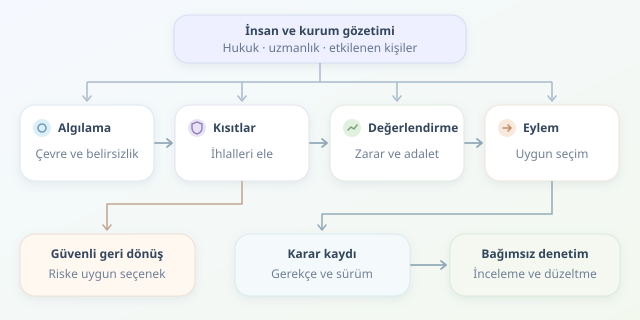

Bir teslimat robotu, kaldırımdaki çocuğa yaklaşınca durmalı mı, yola mı yönelmeli? Sorun yalnızca engelden kaçmak değildir: Kimin güvenliği korunacak, hangi kurallar uygulanacak ve sonuç kötü olduğunda kim açıklama yapacak? Otonom sistemlerde etik karar tasarımı, robota dijital bir vicdan takmaktan çok, değerleri açık kurallara ve denetlenebilir süreçlere dönüştürmektir.

``

## Etik, Tek Bir Puan Değildir

Otonom bir sistem; çevreyi algılar, olası durumları tahmin eder, eylemleri değerlendirir ve harekete geçer. Etik sorunlar bu zincirin tamamına dağılır. Algılama modeli tekerlekli sandalye kullanıcılarını yeterince tanımıyorsa, kusursuz görünen karar algoritması bile adaletsiz sonuçlar üretebilir. Dolayısıyla etik, son aşamada eklenen bir filtre değildir.

Farklı etik yaklaşımlar, farklı tasarım araçlarına dönüşebilir:

| Yaklaşım | Tasarımdaki karşılığı | Temel sınırı |
|---|---|---|
| Sonuç odaklı etik | Beklenen zararı azaltmak | Azınlıkların haklarını gözden kaçırabilir |
| Kural temelli etik | Yasakları kesin kısıt yapmak | Çatışan kurallarda yetersiz kalabilir |
| Adalet odaklı etik | Gruplar arasındaki etkileri ölçmek | Adalet tanımları birbiriyle çatışabilir |

Pratikte bu yaklaşımlar birlikte kullanılır. Önce kabul edilemez eylemler elenir; ardından kalan seçenekler karşılaştırılır. Ancak hangi yasağın mutlak olduğu, yalnızca yazılımcının tercihiyle değil, hukuk, alan uzmanlığı ve etkilenen kişilerle belirlenmelidir.

## Karar Mantığını Matematiğe Dökmek

Basitleştirilmiş bir maliyet fonksiyonu şöyle kurulabilir:

$$J(a)=w_h H(a)+w_s S(a)$$

Burada $H(a)$ tahmini fiziksel zararı, $S(a)$ hizmet kaybını, ağırlıklar ise kurumsal öncelikleri temsil eder. Uygun eylemler kümesi $A_{uygun}$ içinden, maliyeti en düşük seçenek aranır.

Fakat bu denklem ahlaki doğruluğun kanıtı değildir. Ağırlıklar değer yargıları içerir; girdiler hatalı olabilir. İnsan güvenliğini küçük bir teslimat gecikmesiyle kolayca takas edilebilir yapmak da savunulamaz. Bu nedenle güvenlik sınırları, yalnızca ağırlıklı toplamın insafına bırakılmamalıdır. Ayrıca toplanan ölçütlerin ölçekleri karşılaştırılabilir olmalı; puanlar, doğrulanmadan gerçek zarar olasılığı gibi sunulmamalıdır.

## Küçük Bir Karar Motoru

Aşağıdaki Python örneği, dış denetleyicilerin ürettiği kısıt sonuçlarını kullanır. Ardından belirsizliği yüksek seçenekleri eler ve kalanları puanlar. Bu, üretime hazır kontrol yazılımı değil, mimariyi anlatan bir iskelettir.

```python
from dataclasses import dataclass

@dataclass(frozen=True)
class Action:
    name: str
    harm: float
    service_loss: float
    uncertainty: float
    violations: tuple[str, ...] = ()

def decide(actions: list[Action], event_id: str):
    eligible = [
        a for a in actions
        if not a.violations and a.uncertainty <= 0.2
    ]
    chosen = min(
        eligible,
        key=lambda a: 0.9 * a.harm + 0.1 * a.service_loss,
        default=None,
    )
    return {
        'event_id': event_id,
        'policy_version': 'demo-1',
        'decision': chosen.name if chosen else 'FALLBACK',
        'rejected': [a.name for a in actions if a not in eligible],
    }
```

`violations`, kural ihlallerini; `uncertainty`, tahmin güvensizliğini taşır. Örnekteki eşik ve ağırlıklar yalnızca gösterim içindir. Gerçek uygulamada aralık doğrulaması, eksik veri kontrolü ve kalibrasyon gerekir. `FALLBACK` ise otomatik olarak “dur” anlamına gelmez: Güvenli duruş, kontrollü yavaşlama veya operatöre devretme, ortamın risk analizine göre önceden tasarlanmalıdır.

## Şeffaflık ile Hesap Verebilirliği Ayırmak

Şeffaflık, kararın nasıl oluştuğunu anlaşılır kılmaktır. Kullanıcıya “yaya geçişi nedeniyle bekliyorum” demek faydalıdır; denetçiye ise sensör belirsizliği, elenen seçeneklerin gerekçeleri ve kullanılan model sürümü gerekir. Açıklama, gerçek karar mekanizmasına dayanmalı; sonradan üretilmiş ikna edici bir hikâye olmamalıdır.

Hesap verebilirlik ise sorumluluğun adresini belirler. Politikayı kim onayladı? Güncellemeyi kim yayımladı? İtirazı kim inceleyecek? Zaman damgalı, erişimi sınırlı ve değişiklikleri tespit edilebilir kayıtlar bu soruları destekler. Ancak kayıt tutmak tek başına hesap verebilirlik sağlamaz; bağımsız inceleme, düzeltme yetkisi ve gerektiğinde sistemi geri çekme süreci de gerekir. Günlüklerde kişisel veriler asgariye indirilmeli, saklama süreleri tanımlanmalıdır.

## Son Sınav: Gerçek Dünya

Simülasyonlarda yalnızca ortalama başarıyı değil; nadir tehlikeleri, sensör arızalarını ve farklı kullanıcı gruplarındaki sonuçları da ölçmek gerekir. İnsan onayı eklemek sihirli çözüm değildir: Operatörün zamanı, bilgisi ve müdahale yetkisi yoksa bu yalnızca dekor olur.

İyi etik tasarım, “algoritma karar verdi” bahanesini ortadan kaldırır. Asıl hedef kusursuz bir robot filozof değil; sınırları bilinen, kararları incelenebilen ve hatalarından sorumlu kurumlar tarafından yönetilen bir sistemdir.
