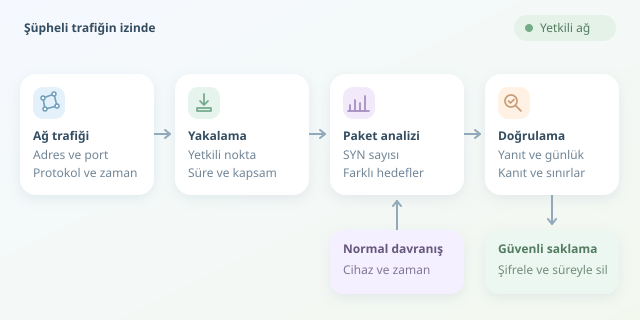

Ağınızda gecenin üçünde yüzlerce bağlantı kuruluyor. Otomatik yedekleme mi çalışıyor, yoksa bir cihaz istenmeyen misafir mi ağırlıyor? Paket analizi, bu soruyu tahminlerden çıkarıp kanıtlara taşır. Ancak dedektifliğin ilk kuralı değişmez: Yalnızca sahibi olduğunuz veya açıkça inceleme yetkiniz bulunan ağlarda çalışın.

``

## 1. Paketler bize ne anlatır?

Ağ iletişimi, katmanlar boyunca kapsüllenen veri birimlerinden oluşur. Ethernet çerçevesi yerel iletimi, IP paketi adreslemeyi, TCP veya UDP ise taşıma davranışını gösterir. Uygulama protokolleri bu yapının üzerinde konuşur; DNS sorguları ve HTTP istekleri bunun örnekleridir.

Bir pakette kaynak ve hedef adresler, portlar, zaman damgası ve protokol bilgisi bulunabilir. Fakat tek paket çoğu zaman hikâyenin yalnızca bir kelimesidir. Anlamı görmek için paketleri akışlar ve zaman çizelgeleri içinde değerlendirmek gerekir.

| Gözlem | Olası açıklama | Tek başına yeterli mi? |
|---|---|---|
| Çok sayıda hedef porta SYN | Port taraması veya envanter aracı | Hayır |
| Düzenli aralıklarla bağlantı | Otomasyon veya komuta-kontrol iletişimi | Hayır |
| Yoğun DNS sorgusu | Servis keşfi veya kötüye kullanım | Hayır |
| Fazla yeniden iletim | Paket kaybı veya tıkanıklık | Hayır |




## 2. Önce normal davranışı tanıyın

Şüpheli davranış, çoğunlukla normalden sapmadır. Bir yedekleme sunucusunun gece yüksek trafik üretmesi beklenirken, yazıcının aynı davranışı göstermesi araştırılmalıdır. Bu yüzden cihaz rolü, çalışma saati ve geçmiş ölçümler birlikte ele alınmalıdır.

Paket hızını $r = N / \Delta t$ ile hesaplayabiliriz. Burada $N$ paket sayısı, $\Delta t$ saniye cinsinden gözlem süresidir. Altmış saniyede 3.000 paket, saniyede 50 paket demektir; bunun anormal olup olmadığına bağlam karar verir.

TCP bağlantısındaki SYN, SYN-ACK ve ACK adımları da önemlidir. Çok sayıda başlangıca karşılık az tamamlanan bağlantı dikkat çekebilir; ancak güvenlik duvarları, paket kaybı ve eksik görünürlük aynı tabloyu oluşturabilir.

## 3. Kontrollü bir yakalama yapın

TShark, Wireshark'ın komut satırındaki çalışma arkadaşıdır. Önce `tshark -D` ile arayüzleri listeleyin. Aşağıdaki örnekte arayüzü ve özel ağ aralığını kendi yetkili ortamınıza göre değiştirin:

```bash
tshark -n -i eth0 \
  -f "net 192.168.10.0/24" \
  -s 128 -a duration:60 \
  -w trafik.pcapng
```

Bu komut, belirtilen ağla ilgili trafiği 60 saniye yakalar. `-n`, adres çözümlemeyi kapatır; `-s 128`, paket başına kaydedilen veriyi 128 baytla sınırlar. Böylece veri miktarı azalır, fakat bazı başlıklar ve uygulama ayrıntıları eksik kalabilir. Ayrıca ilk 128 baytın bile hassas bilgi içerebileceğini unutmayın.

Anahtarlamalı ağlarda kendi bilgisayarınızdan bütün cihazları göremezsiniz. Yetkilendirilmiş bir SPAN portu veya TAP gerekebilir. Yakalama noktasını yanlış seçmek, büyüteci yanlış masaya tutmaya benzer.

## 4. Başlangıç bağlantılarını özetleyin

Yakalama filtresi hangi paketlerin kaydedileceğini, görüntüleme filtresi ise kayıttan hangilerinin gösterileceğini belirler. Sözdizimleri farklıdır. Şimdi yalnızca ACK içermeyen TCP SYN paketlerini CSV dosyasına çıkaralım:

```bash
tshark -r trafik.pcapng \
  -Y 'tcp.flags.syn == 1 && tcp.flags.ack == 0' \
  -T fields -E separator=, \
  -e ip.src -e ip.dst -e tcp.dstport > syn.csv
```

Ardından Python ile her kaynak için farklı hedef adres-port çiftlerini sayabiliriz:

```python
import csv
from collections import Counter, defaultdict

attempts = Counter()
targets = defaultdict(set)

with open("syn.csv", newline="") as file:
    for row in csv.reader(file):
        if len(row) != 3:
            continue
        src, dst, port = row
        if not all((src, dst, port)):
            continue
        attempts[src] += 1
        targets[src].add((dst, port))

for src, total in attempts.most_common(10):
    print(src, "SYN:", total, "farklı hedef:", len(targets[src]))
```

Kod, en fazla başlangıç paketi gönderen IPv4 kaynaklarını ve erişmeye çalıştıkları farklı uçları gösterir. Yeniden iletilen SYN paketleri toplamı artırabilir; benzersiz hedef sayısı bu etkiyi kısmen ayırır. Bu çıktı saldırı kararı değil, inceleme önceliğidir.

## 5. Bulguyu doğrulayın, veriyi koruyun

Öne çıkan kaynağı Wireshark'ta `ip.addr == 192.168.10.25` gibi bir filtreyle inceleyin. Bağlantı yanıtlarını, DNS sorgularını ve zaman aralıklarını karşılaştırın. Ardından uç nokta günlükleriyle eşleştirin: İletişimi hangi süreç başlatmış, zamanlanmış görev var mı?

TLS, uygulama içeriğini genellikle gizler; paket boyutları, zamanlama ve bazı bağlantı bilgileri yine incelenebilir. Görülemeyen içeriği tahminle doldurmayın. Yakalama kayıplarını ve saat uyumsuzluklarını da hesaba katın.

Son olarak PCAP dosyalarını erişim kontrollü ve şifreli saklayın; gerekli süre dolunca silin. İyi analiz, yalnızca şüpheli paketi bulmak değil, bulgunun sınırlarını dürüstçe açıklamaktır.
