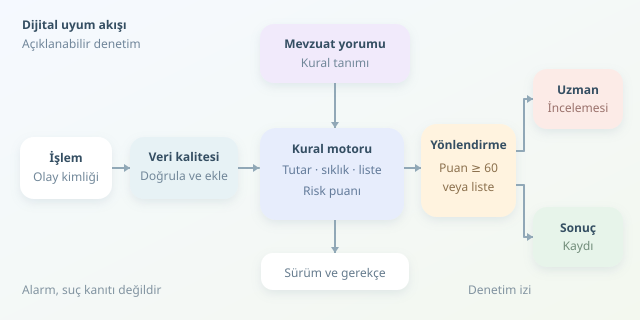

Bir banka uygulamasında para gönderirken arka planda yalnızca bakiye kontrol edilmez. İşlem; müşteri profili, yaptırım listeleri ve şüpheli hareket örüntüleri açısından da değerlendirilebilir. Regülasyon Teknolojisi, yani **RegTech**, bu kontrolleri yazılımla ölçeklendirir. Amaç, mevzuatı sihirli biçimde çözmek değil; ölçülebilir, açıklanabilir ve denetlenebilir süreçler kurmaktır.

``

## Mevzuattan çalıştırılabilir kurala

Bir düzenleme doğrudan `if` koşuluna dönüşmez. Önce hukuk ve uyum ekipleri yükümlülüğü yorumlar; ardından kapsam, gerekli veriler, istisnalar ve uygulanacak aksiyon tanımlanır. Geliştirici bu tanımı çalıştırılabilir kurala dönüştürür. Böylece metinsel bir gereklilik, test edilebilir bir kontrol haline gelir.

Örneğin müşteri tanıma kontrolleri kimlik bilgilerinin yeterliliğini incelerken, kara para aklamayla mücadele kontrolleri işlem örüntülerini araştırır. Ancak **şüphe sinyali, hukuka aykırılığın kanıtı değildir**. Yazılımın ürettiği alarm ile hukuki değerlendirme birbirinden ayrılmalıdır.

| Yaklaşım | Güçlü tarafı | Temel sınırlaması |
|---|---|---|
| Manuel inceleme | Bağlamı yorumlama | Düşük ölçeklenebilirlik |
| Kural motoru | Açıklanabilir karar | Önceden tanımlı örüntüler |
| Makine öğrenmesi | Karmaşık örüntü keşfi | Açıklama ve sapma riski |




## Veri hattı: Dedektifin gözlüğü temiz olmalı

Tipik akış; işlem olayının alınması, verinin doğrulanması, müşteri bilgilerinin zenginleştirilmesi, kuralların çalıştırılması ve sonucun kaydedilmesidir. Eksik müşteri kimliği veya yanlış para birimi, en iyi kuralı bile yanıltır. Bu nedenle veri kalitesi, uyumluluğun yardımcı bileşeni değil, temelidir.

İşlem zamanı ile sisteme ulaşma zamanı da farklı olabilir. Geç gelen kayıtlar günlük toplamları değiştirebilir. Ayrıca aynı olay tekrar işlendiğinde ikinci bir alarm oluşmaması için işlem kimliği üzerinden **idempotent**, yani tekrarlansa da aynı sonucu koruyan bir tasarım gerekir.

## Küçük bir risk motoru yazalım

Eğitim amaçlı modelimizde yüksek tutar, işlem sıklığı ve olası liste eşleşmesi üç sinyal olsun. Ağırlıklı puanımız:

$$R = 40a + 35b + 25c$$

Burada $a$, $b$ ve $c$ sinyal varsa 1, yoksa 0 değerini alır. $R \geq 60$ inceleme başlatır. Olası liste eşleşmesi ise puandan bağımsız incelemeye gider; düşük ağırlığı nedeniyle gözden kaçmaz.

Aşağıdaki Python kodu, pozitif ödemeler için gerekçeli bir değerlendirme üretir. **Eşikler tamamen kurgusaldır; yasal bildirim sınırı değildir.** Tutarların önceden aynı para birimine dönüştürüldüğünü varsayıyoruz.

```python
from dataclasses import dataclass
from decimal import Decimal

@dataclass(frozen=True)
class Islem:
    tutar: Decimal
    gunluk_adet: int
    liste_adayi: bool

def denetle(islem: Islem) -> dict:
    if not islem.tutar.is_finite():
        raise ValueError("Tutar sonlu olmalı")
    if islem.tutar < 0 or islem.gunluk_adet < 1:
        raise ValueError("Geçersiz işlem verisi")

    sinyaller = {
        "tutar": islem.tutar >= Decimal("20000"),
        "siklik": islem.gunluk_adet >= 8,
        "liste": islem.liste_adayi,
    }
    agirliklar = {"tutar": 40, "siklik": 35, "liste": 25}
    puan = sum(agirliklar[k] for k, aktif in sinyaller.items() if aktif)

    return {
        "puan": puan,
        "inceleme": puan >= 60 or sinyaller["liste"],
        "nedenler": [k for k, aktif in sinyaller.items() if aktif],
        "kural_surumu": "demo-1",
    }

print(denetle(Islem(Decimal("24500.00"), 9, False)))
```

Örnekte puan 75 olur ve işlem incelemeye yönlendirilir. `Decimal`, parasal değerlerde ikili kayan nokta kaynaklı yuvarlama sürprizlerini azaltır. Günlük adet mevcut işlemi içerir. `nedenler` alanı alarmın açıklamasını, `kural_surumu` ise sonradan hangi mantığın uygulandığını gösterir. Kod, işlemi otomatik olarak suçlu ilan etmez veya engellemez.

## Üretimde koddan fazlası gerekir

- **Sürümleme:** Kuralların yürürlük tarihleri tutulmalı; geçmiş kararlar o tarihte geçerli kurallarla yeniden üretilebilmelidir.
- **Denetim izi:** Kullanılan veri kaynakları, liste sürümü, karar gerekçesi ve incelemeci aksiyonları yetkisiz değişikliğe karşı korunmalıdır.
- **İnsan incelemesi:** Benzer isimler yanlış yaptırım eşleşmesi oluşturabilir. Ek kimlik bilgileriyle doğrulama yapılmalı; engelleme kararları ilgili yükümlülüklere ve yetkilendirilmiş politikalara dayanmalıdır.
- **Gizlilik:** KVKK gibi uygulanabilir düzenlemeler doğrultusunda erişim sınırlandırılmalı, saklama süreleri belirlenmeli ve günlüklerde gereksiz kişisel veri bulunmamalıdır.
- **Test:** Sınır değerleri, yinelenen olaylar, eksik bilgiler ve saat dilimi farklılıkları özellikle sınanmalıdır.

## Başarı, çok alarm üretmek değildir

Binlerce gereksiz alarm, uzmanları dijital samanlıkta iğne aramaya zorlar. Alarm isabetini $P = TP / (TP + FP)$ ile izleyebilirsiniz. Burada TP doğrulanan, FP yanlış alarmlardır. Ancak yalnızca isabeti yükseltmek yetmez; kaçırılan vakalar, inceleme süresi ve veri kalitesi de takip edilmelidir.

İyi RegTech, mevzuatı birkaç koşula indirgemez. Hukuki yorum, güvenilir veri, açıklanabilir otomasyon ve uzman değerlendirmesini birleştirir. Sonuç, her şeye kırmızı kart gösteren bir robot değil; neden düdük çaldığını anlatabilen bir yardımcıdır.
