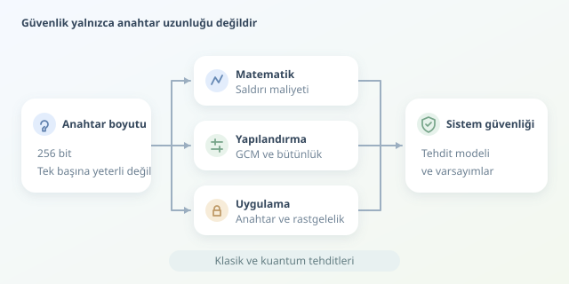

Bir şifreleme algoritmasının adında “256” geçmesi, onu otomatik olarak yenilmez yapmaz. Çelik kapının yanındaki pencere açıksa, kapının kalınlığını tartışmak biraz komiktir. Kriptografide de matematiksel dayanıklılık, doğru uygulama ve anahtar yönetimi birlikte değerlendirilir. Gelin güvenlik seviyelerinin nasıl ölçüldüğünü, rakamların arkasındaki varsayımlarla birlikte inceleyelim.

``

## Güvenlik biti gerçekte ne anlatır?

Güvenlik seviyesi, belirli bir saldırı hedefi için gereken yaklaşık hesaplama maliyetini ifade eder. İdeal bir $k$ bitlik simetrik anahtarı klasik yöntemlerle ararken, ortalama deneme sayısı yaklaşık $W = 2^{k-1}$ olur. Bu nedenle AES-128 için anahtar arama dayanıklılığı yaklaşık 128 bit olarak anılır. Ancak bu, sistemin her saldırıya karşı aynı güvenliği sunduğu anlamına gelmez.

Önce saldırganın yetenekleri tanımlanmalıdır: Yalnızca şifreli metinleri mi görüyor, seçtiği mesajları şifreletebiliyor mu, yoksa değiştirdiği şifreli metinlerin çözümüne ilişkin yanıtlar mı alabiliyor? **IND-CPA** ve **IND-CCA** gibi güvenlik modelleri, gizlilik iddialarını bu yeteneklere göre biçimlendirir. Modelin dışında kalan bir saldırı, matematiksel kanıtla engellenmiş sayılmaz.

## Simetrik ve asimetrik anahtarlar neden farklı uzunlukta?

Simetrik şifreleme ortak bir gizli anahtar kullanır. Asimetrik yöntemlerde ise açık ve özel anahtar bulunur; dayanıklılık, çarpanlara ayırma veya ayrık logaritma gibi problemlere bağlıdır. Bu problemlerin bilinen çözüm maliyetleri farklı olduğundan, anahtar uzunlukları doğrudan karşılaştırılamaz.

| Yöntem | Anahtar boyutu | Yaklaşık klasik güvenlik | Tipik görev |
|---|---:|---:|---|
| AES-128 | 128 bit | 128 bit | Veri şifreleme |
| AES-256 | 256 bit | 256 bit | Veri şifreleme |
| RSA | 3072 bit | 128 bit | Uygun şemayla imza veya anahtar taşıma |
| ECC | 256 bit | 128 bit | Uygun eğriyle anahtar anlaşması veya imza |




Bunlar yaygın parametreler için yaklaşık karşılıklardır; her yapılandırmaya taşınamaz. Ayrıca ECC tek bir şifreleme algoritması değildir. Pratik sistemler çoğunlukla asimetrik mekanizmalarla ortak sır oluşturur, veriyi ise hızlı bir simetrik algoritmayla korur.

## Analiz yalnızca kaba kuvvet hesabı değildir

Sağlam bir inceleme üç katmanda ilerler:

1. **Matematiksel analiz:** Bilinen en iyi saldırıların zaman, bellek ve veri gereksinimleri incelenir. Azaltılmış turlara yönelik akademik bir saldırı, tam algoritmanın pratikte kırıldığı anlamına gelmez.
2. **Yapılandırma analizi:** AES’in hangi çalışma moduyla kullanıldığına bakılır. ECB tekrar eden desenleri açığa çıkarabilir; GCM ise doğru kullanıldığında gizlilik ve bütünlük sağlar. RSA’da ham matematik işlemi yerine uygun, standartlaştırılmış şemalar gerekir.
3. **Uygulama analizi:** Zamanlama sızıntıları, zayıf rastgelelik, hata mesajları ve anahtarların saklanması değerlendirilir. Kusursuz algoritma, günlük dosyasına yazılan anahtarı kurtaramaz.

## Python ile bütünlük kontrolünü görmek

Aşağıdaki örnek, `pip install cryptography` ile kurulabilen kütüphaneyi kullanır. AES-GCM ile mesajı şifreler; ardından şifreli verideki tek bitlik değişikliğin reddedildiğini gösterir.

```python
import os
from cryptography.exceptions import InvalidTag
from cryptography.hazmat.primitives.ciphers.aead import AESGCM

key = AESGCM.generate_key(bit_length=256)
aead = AESGCM(key)
nonce = os.urandom(12)
aad = b"surum=1;tur=mesaj"

ciphertext = aead.encrypt(nonce, "Merhaba!".encode(), aad)
print(aead.decrypt(nonce, ciphertext, aad).decode())

modified = bytearray(ciphertext)
modified[0] ^= 1
try:
    aead.decrypt(nonce, bytes(modified), aad)
except InvalidTag:
    print("Bütünlük doğrulaması başarısız; veri reddedildi.")
```

`aad`, şifrelenmeden doğrulanan ek veridir. Nonce gizli değildir; ancak **aynı anahtarla tekrar kullanılmamalıdır**. Rastgele üretim, tekrar etmeyi matematiksel olarak garanti etmez; yüksek hacimli sistemlerde çakışma olasılığı ve anahtar yenileme sınırları ayrıca yönetilir. Nonce, şifreli veriyle birlikte taşınabilir.

Bu deney AES’in kırılamazlığını kanıtlamaz; yalnızca doğrulamanın çalıştığını gösterir. Ayrıca 256 bitlik AES anahtarı, GCM’nin bütünlük korumasının da 256 bit olduğu anlamına gelmez.

## Kuantum tehdidini doğru okumak

Yeterince güçlü, hata düzeltmeli kuantum bilgisayarlarda Shor algoritması RSA ve yaygın ECC yapılarını tehdit eder. Grover algoritması ise ideal anahtar aramasını yaklaşık $2^{k/2}$ sorguya indirir; gerçek kaynak maliyeti bu basit ifadeden daha karmaşıktır. Kuantum sonrası geçişte standartlaştırılmış ML-KEM gibi anahtar kapsülleme mekanizmaları değerlendirilir; bunlar doğrudan toplu veri şifrelemenin yerine geçmez.

Sonuçta doğru soru “Kaç bit?” değil, **“Hangi tehdit altında, hangi varsayımlarla, ne kadar süre?”** sorusudur. Güncel standartlar, bağımsız inceleme, güvenilir kütüphaneler ve düzenli anahtar yönetimi birlikte değerlendirilmelidir. Güvenlik, yalnızca algoritmanın değil, bütün sistemin özelliğidir.
