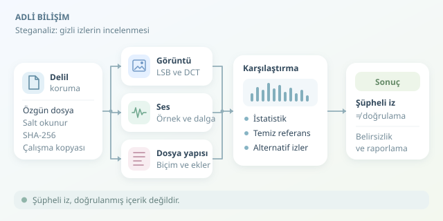

Bir tatil fotoğrafı yalnızca deniz manzarası mı gösterir, yoksa içinde ikinci bir hikâye mi taşır? Steganografi, bilgiyi başka bir dosyanın içinde saklarken steganaliz bu saklama işleminin izlerini arar. Adli bilişim uzmanının görevi, piksellere büyüteç tutmaktan biraz daha karmaşıktır: doğal değişkenlikle bilinçli müdahaleyi birbirinden ayırmak gerekir.

``

## Gizli mesajdan önce gelen soru: Normal olan ne?

Şifreleme, mesajın anlamını gizler; steganografi ise mesajın varlığını saklamaya çalışır. Steganaliz bu nedenle çoğunlukla doğrudan mesaj okumaz. Önce dosyanın beklenen istatistiksel davranışından sapıp sapmadığını araştırır.

Basit bir örnek, görüntüdeki renk değerlerinin en düşük anlamlı bitinin değiştirilmesidir. LSB adı verilen bu yaklaşımda, sekiz bitlik bir piksel bileşeni şu şekilde güncellenebilir:

$$x' = 2\lfloor x/2 \rfloor + m$$

Burada $m$, saklanan sıfır veya bir bitidir. Değişim en fazla bir yoğunluk seviyesidir; gözünüz bunu kaçırabilir, fakat binlerce değişiklik istatistiksel iz bırakabilir. Yine de her steganografi yöntemi LSB kullanmaz.

| İnceleme alanı | Beklenen iz | Önemli sınırlama |
|---|---|---|
| Piksel LSB analizi | Bit dağılımında değişim | Doğal gürültüyle karışabilir |
| JPEG katsayıları | DCT istatistiklerinde sapma | Yeniden sıkıştırma benzer iz bırakabilir |
| Ses örnekleri | Bit veya korelasyon anomalileri | Kayıt cihazı sonucu etkiler |
| Dosya yapısı | Beklenmeyen bloklar, ek veri | Meşru metadata da bulunabilir |




## Önce delili koru, sonra dedektifliğe başla

İnceleme, özgün dosyanın salt okunur korunmasıyla başlamalıdır. Dosyanın SHA-256 özeti alınır; çalışma kopyası, araç sürümleri ve yapılan işlemler kaydedilir. Özet, sonradan değişiklik kontrolü sağlar; tek başına dosyanın kaynağını doğrulamaz.

Ardından uzantı ile gerçek dosya biçimi karşılaştırılır. Metadata, boyut, dosya sonundaki ek baytlar ve kapsayıcı yapısı incelenir. Biçim doğrulayıcıları ve hex görüntüleyiciler burada yararlıdır. Eklenmiş bir arşiv bulmak önemli olabilir; ancak bu bulgu, piksel düzeyinde gizleme yapıldığını göstermez.

## Görsellerde istatistiksel büyüteç

LSB değiştirme, bazı koşullarda komşu değer çiftlerinin frekanslarını birbirine yaklaştırır: örneğin 100 ve 101. Aşağıdaki örnek, kayıpsız RGB bir PNG dosyasının kırmızı kanalında bu çiftleri karşılaştırır. Eğitim amaçlıdır; genel geçer bir dedektör değildir.

```python
from PIL import Image
import numpy as np
from scipy.stats import chi2

with Image.open('inceleme.png') as image:
    if image.format != 'PNG' or image.mode != 'RGB':
        raise ValueError('RGB biçiminde bir PNG gerekli.')
    red = np.asarray(image)[:, :, 0]

hist = np.bincount(red.ravel(), minlength=256)
pairs = hist.reshape(128, 2)
totals = pairs.sum(axis=1)
valid = totals >= 10
expected = totals[valid, None] / 2
score = (((pairs[valid] - expected) ** 2) / expected).sum()
df = int(valid.sum())
p_value = chi2.sf(score, df) if df else float('nan')
print({'chi_square': float(score), 'p_value': float(p_value)})
```

Kod, az örnek içeren çiftleri dışarıda bırakarak eşit frekans varsayımına karşı yaklaşık bir ki-kare testi hesaplar. Büyük p-değeri, bu varsayımla güçlü bir uyumsuzluk görülmediğini söyler; **gizli veri bulunma olasılığını vermez**. Küçük değer de gizleme olmadığını kanıtlamaz. Görüntünün dokusu, işleme geçmişi ve kullanılan yöntem sonucu değiştirebilir. Aynı kaynaktan temiz referanslarla karşılaştırma yapmak, tek dosyayı yorumlamaktan daha değerlidir.

## Ses dosyalarında kulak yetmez

Ses steganalizinde dalga biçimi, spektrogram, örneklerin düşük bitleri ve örnekler arası ilişkiler birlikte değerlendirilir. LSB yöntemleri örnek değerlerini değiştirirken faz kodlama veya yankı tabanlı yöntemler farklı izler bırakabilir. Spektrogramdaki alışılmadık çizgiler araştırma ipucudur; otomatik olarak gizli mesaj anlamına gelmez.

PCM ses incelenirken özgün örnek derinliği korunmalıdır. Yeniden örnekleme, normalizasyon veya kayıplı kodlama, aranan izleri bozabilir. MP3 gibi sıkıştırılmış biçimlerde ise yalnızca çözülmüş sesin LSB değerlerine bakmak yetersizdir; kodlayıcının yapısı ve sıkıştırma alanındaki özellikler ayrıca değerlendirilmelidir.

## Sonuç: Şüphe, kanıtın başlangıcıdır

Güvenilir değerlendirme; yapısal incelemeyi, istatistiksel testleri ve mümkünse bağımsız araçların sonuçlarını birleştirir. Makine öğrenmesi modelleri yardımcı olabilir, ancak farklı kamera veya kodlayıcılarda performansları düşebilir. Düşük yanlış pozitif oranı bile büyük dosya koleksiyonlarında çok sayıda gereksiz alarm üretebilir.

Raporda kullanılan yöntemler, referans veriler, belirsizlikler ve alternatif açıklamalar belirtilmelidir. “Şüpheli özellikler bulundu” ile “gizli içerik doğrulandı” aynı hüküm değildir. Steganalizde iyi dedektiflik, dosyaya suçunu itiraf ettirmek değil; izlerin gerçekten ne söylediğini sabırla anlamaktır.
