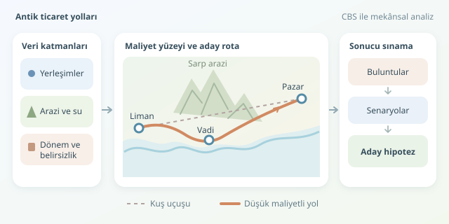

Bir liman, dağ eteğinde bir yerleşim ve uzakta bir pazar merkezi düşünün. Aralarındaki çizgileri birleştirmek kolaydır; fakat antik tüccarın hangi güzergâhı seçtiğini anlamak biraz dedektiflik ister. Coğrafi Bilgi Sistemleri (CBS), konum verilerini arazi koşulları ve arkeolojik bulgularla buluşturarak bu dedektifliğe ölçülebilir bir çerçeve kazandırır.




``

## Noktalardan ilişkilere: Harita neyi anlatır?

Arkeolojik yerleşimler, CBS ortamında koordinatları ve özellikleri bulunan nesnelerdir. Her noktanın yanında tarihleme, yerleşim büyüklüğü, buluntu türleri ve konum doğruluğu gibi bilgiler tutulabilir. Böylece yalnızca “Nerede?” değil, “Hangi dönemde, hangi işlevle?” sorularını da sorabiliriz.

Ancak yakınlık, ticari bağlantının kanıtı değildir. İki yerleşim kuş uçuşu komşu görünürken aralarında sarp bir sırt bulunabilir. Daha uzaktaki bir merkez ise nehir vadisi sayesinde kolay erişilebilir olabilir. Kısacası, antik dünyanın navigasyonu cetvelle çalışmaz!

| Yaklaşım | Ne ölçer? | Temel sınırlama |
|---|---|---|
| Kuş uçuşu mesafe | Doğrusal uzaklık | Arazi engellerini yok sayar |
| En düşük maliyetli yol | Tanımlanan koşullarda en ucuz geçiş | Sonuç, maliyet varsayımlarına bağlıdır |
| Ağ analizi | Merkezler arasındaki bağlantıları | Eksik bağlantılar sonucu değiştirebilir |

## Önce veriyi hazırlayalım

Başlangıç paketi; yerleşim koordinatları, sayısal yükseklik modeli, akarsular, geçitler ve dönemsel kıyı çizgilerinden oluşabilir. Günümüz kıyısını doğrudan antik döneme taşımak hatalıdır: alüvyon birikimi, deniz seviyesi değişimleri ve tektonik hareketler limanların çevresini değiştirmiş olabilir.

Verileri ortak koordinat sistemine dönüştürmek gerekir. Enlem ve boylam derecelerini metre gibi kullanmayın. Çalışma alanına uygun, metre tabanlı bir izdüşüm seçin. Ayrıca aynı analizdeki yerleşimlerin kronolojik olarak örtüşmesini denetleyin; farklı yüzyıllara ait merkezleri aynı ticaret ağında buluşturmak, tarihsel bir grup sohbetine yanlış kişileri eklemek gibidir.

Konum belirsizliğini de saklamayın. Yaklaşık yeri bilinen bir höyük için hata payını kaydetmek, sonraki güzergâh yorumlarının güvenilirliğini artırır.

## Maliyet yüzeyinin mantığı

Araziyi hücrelere ayırdığımızı düşünelim. Her hücre geçişi, mesafe ve hareket güçlüğüne göre bir maliyet taşır. Basitleştirilmiş model şöyle yazılabilir:

$$C(P)=\sum_{(i,j)\in P} d_{ij}k_{ij}$$

Burada $P$ aday güzergâhı, $d_{ij}$ komşu hücreler arasındaki mesafeyi, $k_{ij}$ ise boyutsuz geçiş güçlüğünü gösterir. Bu tanımda sonuç süre değil, mesafeyle ölçeklenen göreli maliyettir. Saat hesaplamak istiyorsanız eğim ve hareket biçimine uygun hız modeli gerekir.

Eğim, zemin ve geçiş koşulları sürtünmeyi artırabilir. Geçilemeyen alanlar yalnızca pahalılaştırılmamalı, modelden çıkarılmalıdır. Nehir geçişleri ise köprü, sığlık veya mevsim bilgisine göre değerlendirilmelidir.

## Python ile küçük bir ağ deneyi

Aşağıdaki örnek, `geopandas`, `networkx` ve `shapely` kullanır. Koordinatlar ve sürtünmeler tamamen sentetiktir. EPSG:32635 burada örnek bir metrik sistemdir; her bölgeye uygun değildir.

```python
import geopandas as gpd
import networkx as nx
from shapely.geometry import LineString

sites = gpd.GeoDataFrame(
    {"id": ["Liman", "Vadi", "Gecit", "Pazar"]},
    geometry=gpd.points_from_xy(
        [500000, 505000, 507000, 512000],
        [4200000, 4201000, 4206000, 4204000]
    ),
    crs="EPSG:32635"
).set_index("id")

edges = [
    ("Liman", "Vadi", 1.1),
    ("Vadi", "Pazar", 1.3),
    ("Liman", "Gecit", 2.4),
    ("Gecit", "Pazar", 1.8)
]

G = nx.Graph()
for a, b, friction in edges:
    distance = sites.loc[a, "geometry"].distance(
        sites.loc[b, "geometry"]
    )
    G.add_edge(a, b, weight=distance * friction)

path = nx.shortest_path(G, "Liman", "Pazar", weight="weight")
line = LineString([sites.loc[n, "geometry"] for n in path])
route = gpd.GeoDataFrame(geometry=[line], crs=sites.crs)
route.to_crs(4326).to_file("aday_rota.geojson", driver="GeoJSON")
print(path)
```

Kod, tanımladığımız bağlantılar arasında toplam ağırlığı en düşük yolu bulur ve GeoJSON olarak kaydeder. Dosyayı QGIS’te açabilirsiniz. Ancak çizgiler gerçek patikalar değildir: bu, maliyetli bağlantı mantığını gösteren küçük bir ağdır. Gerçek raster uygulamasında düğümler hücreleri, kenarlar komşu hücre geçişlerini temsil eder. Yokuş çıkmakla inmek farklı maliyet taşıyorsa yönlü ağ gerekir.

## Sonucu kanıt değil, hipotez olarak okuyun

Aday rotayı seramik dağılımları, köprü kalıntıları, yol izleri ve yazıtlarla karşılaştırın. Ortak buluntular bağlantıyı destekleyebilir; fakat mallar aracılar üzerinden de taşınmış olabilir. Kara ve deniz taşımacılığını aynı sürtünmeyle modellemeyin.

Son olarak eğim ağırlıklarını ve geçiş varsayımlarını değiştirerek analizi tekrarlayın. Farklı senaryolarda korunan koridorlar daha güçlü adaylardır. Yüzey araştırmasının seyrek olduğu bölgelerdeki buluntu eksikliğini de otomatik olarak yol yokluğu saymayın. CBS geçmişi yeniden oynatmaz; hangi tarihsel açıklamaların coğrafyayla daha iyi uyuştuğunu sınamamızı sağlar.
