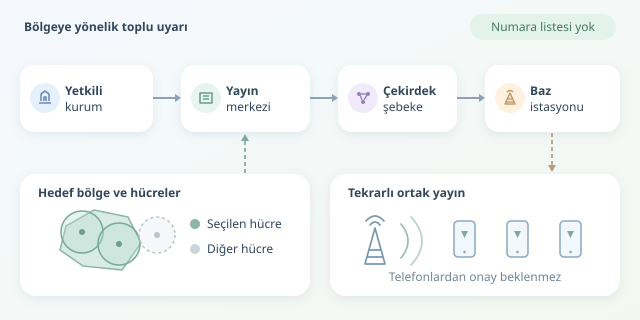

Bir şehirde milyonlarca telefonun aynı uyarıyla ötmesini düşünün. Bunu milyonlarca SMS göndererek yapmak, stadyumdaki herkese haberi tek tek fısıldamaya benzer. Hücre Yayını, yani Cell Broadcast, stadyumun hoparlörünü kullanır: Mesajı belirli mobil şebeke hücrelerinden yayınlar, uyumlu telefonlar dinler. Peki bu dijital megafonun arkasında hangi bileşenler bulunur?

``

## Temel fikir: Aboneye değil, bölgeye yayın

SMS, telefon numarasıyla adreslenen bir hizmettir. Cell Broadcast ise seçilen hücrelerdeki cihazlara ortak bir yayın sunar. Yayının hazırlanması için alıcı telefon numaralarının listelenmesi gerekmez; telefonda ayrıca bir uygulamanın veya internet paketinin bulunması da temel koşul değildir.

| Özellik | SMS | Cell Broadcast |
|---|---|---|
| Hedefleme | Telefon numarası | Hücre veya hücre grubu |
| Dağıtım | Alıcı bazlı | Ortak radyo yayını |
| Ölçek etkisi | Alıcı sayısıyla büyür | Esasen hücre ve tekrar sayısına bağlıdır |
| Teslim bilgisi | Teslim raporu mekanizmaları bulunabilir | Her telefondan alındı onayı beklenmez |

Basitleştirilmiş bir modelde $N$ telefon, $C$ hücre, $r$ tekrar ve $m$ mesaj boyutu için dağıtım yükü şöyle düşünülebilir:

$$W_{SMS}=O(Nm)$$

$$W_{CB}=O(Crm)$$

Bu, gerçek protokol maliyetlerini hesaplayan bir formül değil, ölçek farkını anlatan bir modeldir. Aynı hücredeki telefon sayısı arttığında yayın, her telefon için yeniden gönderilmez. Ancak bundan sabit veya garantili teslim süresi sonucu çıkmaz.

## Uyarının yolculuğu: Yetkiliden antene

İlk durak, yetkili kurumun uyarı oluşturma sistemidir. Operatör; tehlike türünü, hedef bölgeyi, dili, geçerlilik süresini ve mesaj metnini belirler. CAP gibi standartlar, kurumlar arasındaki uyarı alışverişinde kullanılabilir; CAP belgesinin doğrudan telefona yayınlandığını varsaymamak gerekir.

Ardından operatörün yayın merkezi, coğrafi hedefi şebekenin anlayacağı kapsama hedeflerine dönüştürür. Çekirdek şebeke, ilgili erişim düğümlerine uyarı prosedürlerini iletir. Baz istasyonları da mesajı radyo arayüzünde yayınlar.

| Katman | LTE tarafı | 5G tarafı |
|---|---|---|
| Yayın yönetimi | CBC | CBCF |
| Çekirdek şebeke aracısı | MME | AMF |
| Radyo erişimi | eNodeB | gNodeB |

Buradaki CBC, Cell Broadcast Centre; CBCF ise Cell Broadcast Centre Function adıdır. ETWS ve CMAS gibi kamu uyarı mekanizmaları, desteklenen şebeke ve cihazlarda bu altyapıdan yararlanır. Radyo erişiminde uyarılar uygun sistem bilgisi mesajlarıyla taşınır.

## Haritadaki poligon, şebekedeki hücre

En kritik dönüşümlerden biri, “şu ilçeyi uyar” isteğini hücre listesine çevirmektir. Hücrelerin kapsama alanları idari sınırlara uymaz; anten yönü, arazi, frekans ve yük koşulları sonucu etkiler. Bu yüzden komşu bölgedeki bazı telefonlar da uyarı alabilir.

Aşağıdaki Python örneği, `shapely` kullanarak hedef poligonla kesişen örnek hücreleri seçer. Birim testine uygun küçük bir planlama çekirdeğidir; yayın göndermez:

```python
from dataclasses import dataclass
from shapely.geometry import Polygon, box

@dataclass(frozen=True)
class Cell:
    cell_id: str
    footprint: Polygon

def select_cells(region: Polygon, cells: list[Cell]) -> list[str]:
    if region.is_empty or not region.is_valid:
        raise ValueError("Hedef bölge geçerli olmalı")
    return sorted({
        cell.cell_id for cell in cells
        if cell.footprint.intersects(region)
    })

region = box(2, 2, 8, 8)
cells = [
    Cell("A", box(0, 0, 5, 5)),
    Cell("B", box(9, 9, 12, 12)),
]
print(select_cells(region, cells))  # ['A']
```

Koordinatlar yalnızca gösterim amaçlıdır. Gerçek uygulamada geometriler ortak koordinat sisteminde tutulmalı, kapsama verisi güncellenmeli ve sınır durumları test edilmelidir. Bazı ekosistemlerde cihaz tarafında coğrafi filtreleme de bulunabilir; bunu evrensel özellik saymamak gerekir.

## Güvenilirlik: Göndermek, göstermek değildir

Mesaj kimliği ve seri numarası, tekrarların ve güncellemelerin yönetilmesine yardımcı olur. Tekrar yayınları, hücreye sonradan giren veya ilk yayını kaçıran cihazların uyarıyı yakalama olasılığını artırır. Dil, karakter kodlaması ve segment sınırları da test edilmelidir; uzun metin her zaman daha iyi uyarı değildir.

Şebekeden alınan işlem yanıtları, bütün telefonların mesajı gösterdiğini kanıtlamaz. Kapsama, cihaz uyumluluğu, yazılım ve yerel uyarı ayarları sonucu etkiler. Dolayısıyla “herkese aynı anda” ifadesi, kesin bir teslim garantisi değil, mimarinin kitlesel yayın hedefidir.

## Güçlü megafona güçlü kilit

Üretim sisteminde rol tabanlı yetkilendirme, hassas işlemlerde çift onay, kimliği doğrulanmış bağlantılar ve değiştirilemez denetim kayıtları tasarlanmalıdır. Test yayınları canlı uyarılardan ayrılmalı; iptal, güncelleme ve süre sonu senaryoları düzenli denenmelidir.

Başarı ölçütü yalnızca kaç mesaj üretildiği değildir: Doğru bölgeyi seçmek, anlaşılır eylem talimatı vermek ve sistemi krizden önce sınamak gerekir. Megafon güçlü olabilir; asıl mühendislik, doğru zamanda doğru şeyi söylemesidir.
