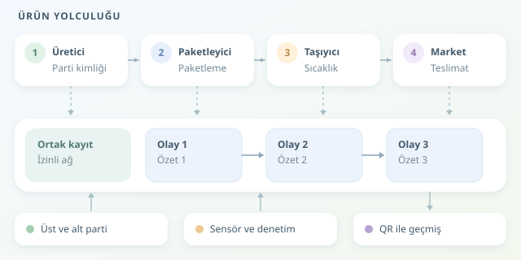

Marketten aldığınız bal gerçekten etiketteki bölgeden mi geliyor? Soğuk zincirde taşınması gereken ilaç, yol boyunca uygun sıcaklıkta mı tutuldu? Tedarik zincirinde bu soruların cevabı çoğu zaman farklı şirketlerin sistemlerine dağılır. Blok zincir, tarafların ortak bir geçmiş üzerinde uzlaşmasını sağlayarak ürünün yolculuğunu daha denetlenebilir hâle getirebilir.

``

## Bir kavanoz balın dijital pasaportu

Yolculuk, üreticinin bal partisine benzersiz bir kimlik vermesiyle başlar. Paketleyici, taşıyıcı ve market, bu kimlikle ilişkili olaylar ekler. Her olay; aktör, zaman, konum ve işlem türü gibi alanlar içerir. Böylece yalnızca ürünün nerede olduğu değil, hangi aşamalardan geçtiği de görülebilir.

Ancak ürünler her zaman tek parça ilerlemez. Bir parti yüzlerce kavanoza bölünebilir; farklı partiler aynı sevkiyatta birleşebilir. Bu nedenle sistem, **üst parti–alt parti ilişkilerini** de kaydetmelidir. Aksi hâlde dijital pasaport, yolculuğun yarısında hafızasını kaybeder! GS1 EPCIS gibi standartlar, şirketlerin olayları ortak bir dille paylaşmasına yardımcı olur.

## Değiştirilemezlik sihir değil, tasarımdır

Temel fikir, kayıtları kriptografik özetlerle birbirine bağlamaktır. Basitleştirilmiş bir modelde yeni özet şöyle hesaplanır:

$$h_i = H(h_{i-1}, e_i)$$

Burada $e_i$ olay verisini, $h_{i-1}$ önceki özeti, $H$ ise SHA-256 gibi bir özet fonksiyonunu temsil eder. Eski bir olay değiştirilirse sonraki bağlantılar tutarsızlaşır. Gerçek blok zincirlerde olaylar genellikle bloklarda gruplanır; dijital imzalar yetkilendirilmiş anahtarın kullanımını doğrular, uzlaşma mekanizması hangi geçmişin kabul edileceğini belirler.

Dolayısıyla “değiştirilemez”, hiçbir koşulda değiştirilemez demek değildir. Güvence; doğrulayıcıların bağımsızlığına, anahtar güvenliğine ve ağın yönetim kurallarına bağlıdır.

| Yaklaşım | Güven modeli | Başlıca sınırlama |
|---|---|---|
| Merkezi veritabanı | Tek işletmeciye güven | Yönetici geçmişi değiştirebilir |
| İzinli blok zincir | Yetkili kurumlar birlikte doğrular | Kurumlar anlaşarak sistemi etkileyebilir |
| Açık blok zincir | Protokol ve ekonomik teşvikler | Ücret, mahremiyet ve kapasite sorunları |




Tedarik zincirinde izinli ağlar sık değerlendirilir; çünkü katılımcılar genellikle bilinen şirketlerdir. Yine de tek şirketin yönettiği bir süreçte, imzalı ve denetlenebilir bir veritabanı daha ekonomik olabilir. Blok zincir, her lojistik sorununa sürülecek dijital ketçap değildir.

## Python ile kurcalamayı fark etmek

Aşağıdaki örnek, olayların özetlerle bağlanmasını gösterir. `sort_keys` ve sabit ayraçlar, aynı alanların bu örnekte tutarlı biçimde serileştirilmesini sağlar. `dogrula`, zinciri baştan hesaplayarak saklanan özetlerle karşılaştırır.

```python
import hashlib
import json


def ozet(onceki, olay):
    veri = {"onceki": onceki, "olay": olay}
    metin = json.dumps(veri, sort_keys=True, separators=(",", ":"))
    return hashlib.sha256(metin.encode("utf-8")).hexdigest()


def dogrula(kayitlar):
    onceki = "0" * 64
    for olay, beklenen in kayitlar:
        hesaplanan = ozet(onceki, olay)
        if hesaplanan != beklenen:
            return False
        onceki = hesaplanan
    return True


olay = {"parti": "BAL-042", "adim": "paketleme"}
kayitlar = [(olay, ozet("0" * 64, olay))]
print(dogrula(kayitlar))  # True

olay["adim"] = "teslimat"
print(dogrula(kayitlar))  # False
```

Bu kod bir blok zincir ağı değildir; imza, yetkilendirme ve dağıtık uzlaşma içermez. Saldırgan bütün özetleri yeniden yazabiliyorsa kontrolü aşabilir. Gerçek güvence için bağımsız kopyalar, güvenilir kontrol noktaları ve uygun bir uzlaşma tasarımı gerekir.

## Zincir doğruysa ürün de doğru mudur?

Maalesef hayır. Sensör bozuksa veya görevli yanlış bilgi girerse, zincir yanlış veriyi tutarlı biçimde saklar. Fiziksel dünya ile dijital kayıt arasındaki bu bağlantı, **oracle problemi** olarak bilinir. Güvenilir sensörler, mühürler, kalibrasyon ve saha denetimleri bu yüzden kritiktir.

Pratik bir uygulamada şu ayrıntılar özellikle önemlidir:

- **Mahremiyet:** Ticari belgeleri ve kişisel verileri zincir dışında tutun; gerektiğinde yalnızca özetlerini kaydedin.
- **Düzeltmeler:** Hatalı kaydı silmek yerine, onu açıklayan ve geçersiz kılan yeni olay ekleyin.
- **Erişim:** Tüketiciye QR kodla sade bir geçmiş gösterin; hassas bilgileri yetkilendirmeyle sınırlandırın.
- **Fiziksel bağ:** Kopyalanabilen QR etiketini tek başına özgünlük kanıtı saymayın.

Başarılı bir pilot, tek ürün grubuyla başlayıp geri çağırma süresi ve eksik kayıt oranı gibi ölçümleri izler. Asıl kazanım yalnızca kayıt tutmak değildir: Bir sorun çıktığında hangi partinin, nerede ve kimlerin elinden geçtiğini hızla bulabilmektir. Şeffaflık, teknoloji kadar doğru süreç tasarımıyla büyür.
