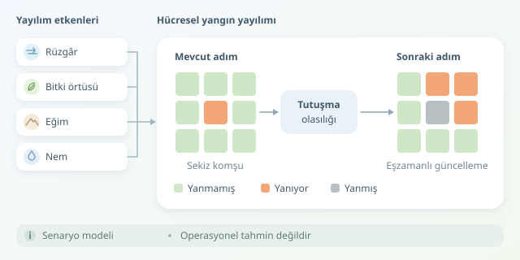

Bir ormanı dev bir piksel haritasına dönüştürdüğünüzü düşünün: Her piksel bir arazi parçası, her zaman adımı ise yangının bir sonraki hamlesi. Hücresel otomata, bu basit fikirle rüzgârın, bitki örtüsünün ve eğimin birleşerek yangın cephesini nasıl şekillendirdiğini araştırmamızı sağlar. Ancak piksel ordumuzun kahin değil, varsayımlarla çalışan bir model olduğunu unutmayalım!




``

## Orman, durumlar ve komşular

Hücresel otomata; bir ızgara, hücre durumları ve yerel geçiş kurallarından oluşur. Her hücreyi örneğin 30 × 30 metrelik bir alan kabul edebiliriz. Zamanı da 30 saniyelik adımlarla ilerletiriz. Hücrenin geleceği, mevcut durumu ve çevresindeki hücrelerle belirlenir.

| Durum | Kod | Anlamı |
|---|---|---|
| Yanmamış | 0 | Yakıt varsa tutuşabilir |
| Yanıyor | 1 | Komşulara yangın aktarabilir |
| Yanmış | 2 | Bu modelde yeniden tutuşmaz |

Sekiz çevre hücresini kullanan **Moore komşuluğu**, çapraz yayılımı da içerir. Güncellemeler eşzamanlı yapılmalıdır: Önce bütün olasılıklar hesaplanır, sonra durumlar değiştirilir. Aksi hâlde döngünün tarama yönü, yangına gizlice yön verebilir!

## Yayılım olasılığı nereden geliyor?

Basit bir modelde, yanan $i$ hücresinin yanmamış $j$ komşusuna katkısını bir tutuşma hızıyla tanımlayabiliriz:

$$\lambda_{ij}=\lambda_0 F_j\exp\left(a\,\mathbf{u}\cdot\mathbf{e}_{ij}+b\frac{z_j-z_i}{d_{ij}}-cM_j\right)$$

Burada $F_j$ normalize edilmiş yanabilir yakıt katsayısı, $M_j$ normalize nem göstergesi, $z$ yükseklik, $d_{ij}$ hücre merkezleri arasındaki mesafedir. Rüzgâr vektörü $\mathbf{u}$ ile yayılım yönü $\mathbf{e}_{ij}$ arasındaki skaler çarpım, rüzgârın yangını destekleyip desteklemediğini anlatır.

| Etken | Artınca beklenen etki | Modelde karşılığı |
|---|---|---|
| Yanabilir yakıt | Tutuşma kolaylaşır | $F_j$ büyür |
| Yayılım yönündeki rüzgâr | Yayılım hızlanır | Üstel terim büyür |
| Yukarı eğim | Yayılım desteklenir | Yükseklik farkı pozitiftir |
| Nem | Tutuşma zorlaşır | Üstel terim küçülür |

Bu, açıklayıcı bir parametrizasyondur; evrensel fizik yasası değildir. $\lambda_0$ saniye başına hızdır; katsayıların birimleri üssü boyutsuz yapacak şekilde seçilir. Komşu katkılarını bağımsız tehlike kaynakları gibi toplarsak, zaman adımındaki tutuşma olasılığı şöyle olur:

$$P_j=1-\exp\left(-\Delta t\sum_i\lambda_{ij}\right)$$

Böylece olasılık doğal olarak sıfır ile bir arasında kalır. Birden fazla yanan komşu, tutuşma ihtimalini artırır.

## Python ile küçük bir deney

Aşağıdaki fonksiyon tek adımı hesaplar. NumPy dizileri aynı boyutta olmalıdır; yakıt ve nem değerleri 0–1 aralığındadır. Rüzgâr, rasterin satır ve sütun eksenlerinde metre/saniye bileşenleriyle verilir. Katsayılar yalnızca gösterim amaçlıdır.

```python
import numpy as np

def step(state, z, fuel, moisture, wind, rng, dt=30, cell=30):
    rows, cols = state.shape
    hazard = np.zeros(state.shape)
    offsets = [(dr, dc) for dr in (-1, 0, 1)
               for dc in (-1, 0, 1) if dr or dc]

    for r, c in np.argwhere(state == 1):
        for dr, dc in offsets:
            rr, cc = r + dr, c + dc
            if not (0 <= rr < rows and 0 <= cc < cols):
                continue
            if state[rr, cc] != 0:
                continue

            direction = np.array([dr, dc], dtype=float)
            direction /= np.linalg.norm(direction)
            distance = cell * np.hypot(dr, dc)
            slope = (z[rr, cc] - z[r, c]) / distance
            exponent = (0.2 * np.dot(wind, direction)
                        + 4 * slope - 3 * moisture[rr, cc])
            hazard[rr, cc] += (0.002 * fuel[rr, cc]
                              * np.exp(exponent))

    probability = -np.expm1(-hazard * dt)
    new = state.copy()
    new[state == 1] = 2
    ignite = (state == 0) & (rng.random(state.shape) < probability)
    new[ignite] = 1
    return new
```

`hazard`, komşu katkılarını biriktirir; `expm1`, küçük değerlerde sayısal hassasiyeti korur. `rng` için `np.random.default_rng(42)` kullanmak deneyi tekrarlanabilir yapar. Burada yanan hücre bir adım sonra söner; gerçekçi modellerde yanma süresi ayrıca izlenmelidir.

## Güzel animasyon, doğru tahmin demek değildir

Yükseklik, bitki örtüsü ve meteoroloji katmanlarını aynı koordinat sistemine, çözünürlüğe ve zamana hizalayın. Kategorik örtü verisini yeniden örneklerken sınıfları birbirine karıştırmayın. Ardından geçmiş yangın çevreleri ve varış zamanlarıyla kalibrasyon yapın; başarıyı farklı yangınlarda sınayın.

Tek koşu yerine farklı rastgele tohumlarla çok sayıda simülasyon üretin. Bir hücrenin yandığı koşuların oranı, model varsayımlarına bağlı bir olasılık haritası verir. Rüzgâr senaryolarını değiştirerek belirsizliği görünür kılabilirsiniz.

Son olarak, kıvılcım taşınımı, değişken hava ve söndürme faaliyetleri bu örnekte yoktur. Bu çalışma öğrenme ve senaryo karşılaştırması içindir; gerçek zamanlı operasyonel tahmin veya tahliye kararı aracı değildir.
