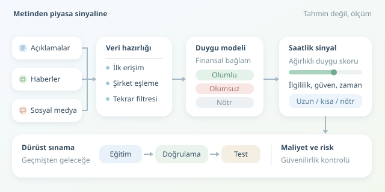

Bir şirket rekor kâr açıklarken hissesi neden düşer? Çünkü piyasalar yalnızca gerçekleşen sonuçları değil, beklentilerle sonuçlar arasındaki farkı fiyatlar. Haberler ve sosyal medya, bu beklentilerin izlerini taşır. Duygu analizi ise milyonlarca cümleyi ölçülebilir sinyallere dönüştürmeye çalışır. Ancak piyasanın ruh hâlini okumak, geleceği görmek değildir!

``

## Duygu analizi gerçekte neyi ölçer?

Doğal dil işleme modelleri, metinleri olumlu, olumsuz veya nötr olarak sınıflandırabilir. Finans alanında eğitilmiş bir model, “borç azaltımı” ifadesinin çoğu durumda olumlu olabileceğini, “rekor zarar” ifadesininse farklı değerlendirilmesi gerektiğini öğrenir. Genel amaçlı modeller finansal bağlamı kaçırabilir; Türkçe metinlerde dil ve alan uyumu ayrıca önemlidir.

Bir haber için basit duygu skoru şöyle tanımlanabilir:

$$s_i=P(\text{olumlu}\mid x_i)-P(\text{olumsuz}\mid x_i)$$

Burada $x_i$ metni, $s_i$ ise $[-1,1]$ aralığındaki skoru gösterir. Modelin olasılıkları iyi kalibre edilmemişse bu sayı güvenilir bir kesinlik ölçüsü değildir. Ayrıca olumlu haber, mutlaka olumlu getiri demek değildir: Beklentinin altında kalan büyüme, kulağa güzel gelse de satış getirebilir.

| Kaynak | Güçlü tarafı | Temel riski |
|---|---|---|
| Şirket açıklamaları | Doğrudan bilgi | Seçici ve iyimser dil |
| Haber siteleri | Editoryal bağlam | Gecikme ve tekrar |
| Sosyal medya | Hızlı tepki | Botlar, ironi, manipülasyon |

## Metinden işlem sinyaline

İlk adım veri toplamaktır; ikinci adım, verinin gerçekten ne zaman bilindiğini belirlemektir. Yayın zamanı, sistemin haberi ilk gördüğü anla aynı olmayabilir. Geriye dönük düzeltilmiş bir metni geçmişte biliniyormuş gibi kullanmak, modele zaman makinesi hediye etmektir. Bu nedenle ilk erişim zamanı, metin sürümü ve kaynak bilgisi saklanmalıdır.

Ardından şirket adları ve işlem sembolleri eşleştirilir. “Apple” geçen her cümle teknoloji hissesiyle ilgili değildir; bazen gerçekten meyveden söz ediliyordur. Tekrarlanan haberler ayıklanır, alıntılar ve bot kaynaklı içerikler ayrıca değerlendirilir.

Birden fazla metni birleştirmek için ağırlıklı ortalama kullanılabilir:

$$S_t=\frac{\sum_i w_i s_i}{\sum_i w_i}$$

Ağırlıklar; şirketle ilgililik, kaynak güvenilirliği ve haberin yaşına göre belirlenebilir. Örneğin $w_i=q_i e^{-\lambda\Delta t_i}$, eski haberlerin etkisini azaltır. Burada $q_i$ kalite katsayısı, $\lambda$ ise unutma hızıdır. Bunlar gelecekteki sonuçlara bakılarak seçilmemelidir.

## Python ile saatlik sinyal üretimi

Aşağıdaki örnek, modelin önceden ürettiği olumlu ve olumsuz olasılıkları kullanır. `relevance`, sıfır ile bir arasındaki ilgililik ağırlığıdır. Kod tek bir varlık için haberleri saatlik toplar; tamamlanmamış saatin bilgisini kullanmamak için skoru bir dönem kaydırır.

```python
import numpy as np
import pandas as pd


def hourly_signal(news, ticker):
    d = news.loc[news['ticker'].eq(ticker)].copy()
    d['ts'] = pd.to_datetime(d['first_seen'], utc=True)
    d = d.sort_values('ts').drop_duplicates('news_id')
    d['weighted'] = (d['p_pos'] - d['p_neg']) * d['relevance']

    h = d.set_index('ts').resample('1h').agg(
        total=('weighted', 'sum'),
        weight=('relevance', 'sum')
    )
    h['sentiment'] = h['total'].div(h['weight'].replace(0, np.nan))
    known = h['sentiment'].shift(1)
    h['target'] = np.select(
        [known.gt(0.2), known.lt(-0.2)],
        [1, -1], default=0
    )
    return h[['sentiment', 'target']]
```

`target`, sırasıyla uzun, kısa veya nötr hedefi temsil eder; emir göndermez. Eşikler yalnızca örnektir. Habersiz saatlerde nötr hedef oluşur. Gerçek uygulamada işlem takvimi, veri gecikmesi, açığa satış kısıtları ve emir gerçekleşme zamanı ayrıca modellenmelidir. Sinyalin oluşması, aynı fiyattan işlem yapılabileceği anlamına gelmez.

## Başarıyı nasıl sınarız?

Asıl soru, duygu skorunun gelecekteki getiriler hakkında mevcut fiyat ve hacmin ötesinde bilgi taşıyıp taşımadığıdır. Bunu ölçmek için veriyi rastgele karıştırmak yerine kronolojik eğitim, doğrulama ve test dönemlerine ayırın. İlerleyen pencere testleriyle modeli yalnızca geçmiş verilerle güncelleyin. Model seçimi ve eşik ayarlarını test döneminden uzak tutun.

- **Maliyetleri ekleyin:** Komisyon, alış-satış farkı ve kayma küçük avantajları silebilir.
- **Basit referanslarla karşılaştırın:** Aynı risk düzeyindeki fiyat tabanlı stratejilere gerçekten katkı var mı?
- **Rejimleri inceleyin:** Krizde çalışan ilişki sakin piyasada kaybolabilir.
- **Dayanıklılığı ölçün:** Birkaç viral paylaşım çıkarılınca sonuç çöküyorsa sinyal kırılgandır.

Sonuç olarak duygu analizi, piyasaya takılan sihirli bir termometre değildir. Daha çok gürültülü bir mikrofon gibidir: Doğru filtreler, zaman damgaları ve dürüst testlerle işe yarayabilir. En değerli çıktı bazen “işlem yap” değil, “burada güvenilir bilgi yok” sonucudur.



