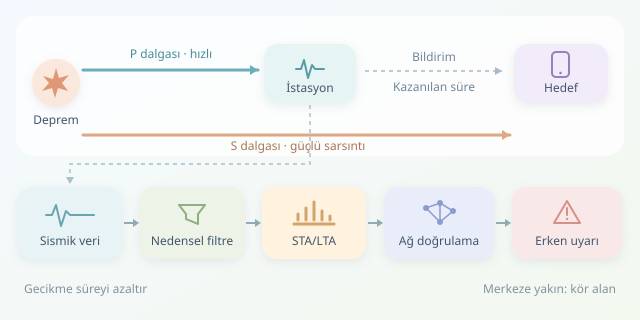

Bir deprem başladığında telefonunuzun güçlü sarsıntıdan birkaç saniye önce uyarı verdiğini düşünün. Bu, geleceği görmek değil; farklı hızlarda ilerleyen deprem dalgalarıyla yapılan bir yarıştır. Erken uyarı sistemleri, önce ulaşan P dalgasını yakalayarak daha yavaş gelen S dalgası ve ardından gelişebilecek güçlü sarsıntılar için zaman kazanmaya çalışır.
``

## Yarışın fiziği: Kazanılabilecek süre nereden gelir?

P dalgaları ortamı ilerleme doğrultusunda sıkıştırıp genişletir; S dalgaları ise parçacıkları ilerleme doğrultusuna dik hareket ettirir. Kabuk içinde örnek hızlar sırasıyla yaklaşık $6$ ve $3{,}5\ \text{km/s}$ olabilir. Gerçek hızlar jeolojik yapıya göre değişir.

Bir istasyonun deprem kaynağına uzaklığı $r_d$, korunacak hedefin uzaklığı $r_t$ ise yaklaşık kullanılabilir süre şöyledir:

$$T_{uyari}\approx\frac{r_t}{v_S}-\frac{r_d}{v_P}-\tau$$

Buradaki $\tau$; algılama, iletişim, hesaplama ve bildirimin toplam gecikmesidir. İstasyonla hedefin aynı noktada bulunduğunu, kaynak uzaklığının 60 kilometre ve toplam gecikmenin iki saniye olduğunu varsayarsak yaklaşık beş saniye kalır. Sonuç sıfırın altındaysa zamanında uyarı mümkün değildir: merkez üssüne yakın bölgelerdeki kör alanın temel nedeni budur.

## Gürültünün içinden P dalgasını seçmek

Sensör yalnızca depremi dinlemez; trafik, makineler ve elektriksel parazitler de kayda girer. Bu nedenle işlem hattı zaman damgası kontrolü, veri kalitesi değerlendirmesi ve nedensel bant geçiren filtreleme içerir. Örneğin 100 Hz örneklenen veride 1–15 Hz başlangıç bandı denenebilir; ancak uygun bant, istasyonun gürültüsüne ve hedeflenen olaylara göre belirlenmelidir.

Klasik STA/LTA yaklaşımı kısa ve uzun pencerelerdeki ortalama enerjiyi karşılaştırır:

$$R[n]=\frac{STA(y^2[n])}{LTA(y^2[n])+\epsilon}$$

Burada $y[n]$ filtrelenmiş örnek, $\epsilon$ ise sıfıra bölünmeyi önleyen küçük sayıdır. Kısa pencere ani başlangıca hızla tepki verirken uzun pencere arka planı temsil eder. Oran yükselirse sistem “burada yeni bir şey başladı” der; henüz “kesin deprem” demez.

| Yaklaşım | Güçlü yanı | Temel sınırlaması |
|---|---|---|
| STA/LTA | Hızlı, açıklanabilir, düşük maliyetli | Ani çevresel gürültüyle tetiklenebilir |
| AIC tabanlı seçim | Aday başlangıç zamanını hassaslaştırabilir | Ek analiz penceresi gecikme yaratabilir |
| Sinir ağı tabanlı seçici | Karmaşık dalga biçimlerini öğrenebilir | Farklı istasyonlarda başarımı değişebilir |




## Python ile akış üzerinde aday üretmek

Aşağıdaki sınıf, önceden nedensel olarak filtrelenmiş örnekleri tek tek işler. Kayan toplamlar sayesinde her güncellemede pencereyi baştan hesaplamaz. Eşiklerin kısa süre korunmasını istemek, tek örneklik sıçramaları elemek içindir.

```python
from collections import deque

class STALTA:
    def __init__(self, fs=100):
        self.ns, self.nl = int(0.3 * fs), int(5 * fs)
        self.windows = [deque(), deque()]
        self.sums = [0.0, 0.0]
        self.required = max(1, int(0.15 * fs))
        self.hits = 0
        self.armed = True

    def update(self, sample):
        energy = float(sample) ** 2
        for i, size in enumerate((self.ns, self.nl)):
            self.windows[i].append(energy)
            self.sums[i] += energy
            if len(self.windows[i]) > size:
                self.sums[i] -= self.windows[i].popleft()

        if len(self.windows[1]) < self.nl:
            return False

        sta = self.sums[0] / self.ns
        lta = self.sums[1] / self.nl
        ratio = sta / (lta + 1e-12)
        self.hits = self.hits + 1 if ratio >= 3.5 else 0
        if ratio < 1.5:
            self.armed = True
        if self.armed and self.hits >= self.required:
            self.armed = False
            return True
        return False
```

İlk beş saniye arka plan penceresini doldurur. Oran 3,5 üzerinde yaklaşık 150 milisaniye kaldığında aday üretilir. Yeniden tetiklenmek için oranın 1,5 altına düşmesi gerekir; bu histerezis, aynı olayda alarm yağmurunu azaltır. Sayılar evrensel değildir. Veri boşluklarında durum sıfırlanmalı; filtre durumu paketler arasında korunmalıdır. Gelecek örnekleri kullanan sıfır fazlı filtreleme, gerçek zamanlı gecikmeyi gizlediğinden bu akışa doğrudan uygun değildir.

## Adaydan güvenilir uyarıya

Tek istasyondaki eşik aşımı halka bildirim göndermek için yeterli değildir. Birden fazla istasyonun tutarlı varış zamanları, dalga biçimi özellikleri ve ağ geometrisi birlikte değerlendirilir. Ardından kaynak konumu ve beklenen yer hareketi, belirsizlikleriyle birlikte güncellenir. İlk birkaç saniyeden nihai büyüklüğü kusursuz çıkarmak mümkün değildir.

Başarı yalnızca doğruluk yüzdesiyle ölçülmez: yanlış alarm, kaçırılan olay, başlangıç zamanı hatası ve uçtan uca gecikme birlikte izlenmelidir. Test verisi farklı bölgeleri ve gerçek gürültüyü kapsamalıdır. Amaç depremi önceden tahmin etmek değil; başlamış bir olayda, güvenilir biçimde kazanılabilen saniyeleri otomatik koruyucu işlemlere dönüştürmektir.
