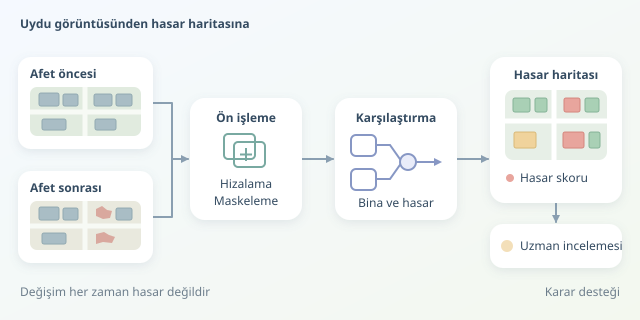

Bir depremden sonra binlerce binayı tek tek incelemek zaman alır; oysa müdahale ekiplerinin hızlı bir ön değerlendirmeye ihtiyacı vardır. Uydu görüntüleri burada gökyüzündeki karşılaştırma makinesi gibi çalışır: Afet öncesindeki düzen ile sonrasındaki değişimi eşleştirir. Ancak her değişiklik yıkım değildir. İşin asıl zekâsı, bu ikisini ayırabilmektedir.

``

## Piksel değişimi neden hasar anlamına gelmez?

En basit yaklaşım, aynı konumun iki tarihteki parlaklık değerlerini çıkarmaktır:

$$D(x,y)=\vert I_1(x,y)-I_0(x,y)\vert $$

Burada $I_0$ afet öncesini, $I_1$ afet sonrasını temsil eder. Büyük farklar değişim adayıdır; fakat değişimin nedeni gölge, kar, mevsim veya farklı çekim açısı olabilir. Yani piksel farkı bir alarm zilidir, bilirkişi raporu değildir.

Üstelik birkaç piksellik hizalama hatası, sağlam bir binanın kenarında sahte değişim üretir. Bu yüzden geometrik eşleştirme, ortorektifikasyon ve uygun radyometrik normalizasyon model seçiminden önce gelir. Çözünürlük de önemlidir: Tek bir piksele sığan küçük bir yapının hasarını güvenilir biçimde sınıflandırmak zordur.

## Model gerçekte ne öğrenir?

Problem genellikle iki aşamaya ayrılır: Önce bina konumları bulunur, ardından her binanın hasar durumu sınıflandırılır. Bina konumları mevcut haritalardan veya görüntü segmentasyonundan gelebilir. Önceki görüntü özellikle değerlidir; tamamen yıkılan bir bina, sonraki görüntüde artık bina gibi görünmeyebilir.

Derin öğrenmede yaygın seçeneklerden biri, iki tarihi ayrı kollarda işleyen Siamese mimaridir. Özellikler karşılaştırılır; çatı bütünlüğü, doku ve çevresel değişimler birlikte değerlendirilir. Bazı mimariler kollar arasında ağırlık paylaşırken, bazıları görüntüler arası etkileşimi dikkat mekanizmalarıyla kurar.

| Yaklaşım | Avantajı | Temel sınırı |
|---|---|---|
| Piksel farkı | Hızlı ve açıklanabilir | Gölgelere duyarlı |
| Bina özellikleri + sınıflandırıcı | Az veriyle başlangıç | Mekânsal ayrıntıyı özetler |
| Siamese segmentasyon | Karmaşık örüntüleri öğrenir | Etiketli veri ve hesaplama ister |

Bir bina için çıktı $p_i=P(y_i=1\vert z_i)$ şeklinde düşünülebilir. Burada $z_i$ karşılaştırmalı özellikleri, $y_i=1$ hedef hasar sınıfını gösterir. Bu skorun gerçek bir olasılık gibi yorumlanması ise ayrıca kalibrasyon gerektirir.

## Veriden çalışan bir başlangıç modeline

Önce görüntüler aynı koordinat sistemine ve piksel ızgarasına getirilir. Bulut, gölge ve geçersiz pikseller maskelenir; yetersiz gözlemi bulunan binalar değerlendirme dışına alınır. Ardından bina sınırları üzerinden iki tarihin özellikleri çıkarılır. Eğitim etiketleri bağımsız hasar değerlendirmelerinden gelmeli; yalnızca görüntü farkına bakılarak otomatik üretilmemelidir.

Aşağıdaki örnek, hazırlanmış veriler üzerinde bina başına bant ortalamalarını ve mutlak değişim istatistiklerini hesaplar. `once` ve `sonra`, `(yükseklik, genişlik, bant)` biçimindedir; `maskeler` geçerli bina piksellerini seçer. `y`, yıkılmış için 1, diğerleri için 0 etiketini; `bolgeler` ise coğrafi grup kimliğini taşır. Her maskede yeterli sayıda geçerli piksel bulunduğu varsayılır.

```python
import numpy as np
from sklearn.ensemble import RandomForestClassifier
from sklearn.model_selection import GroupShuffleSplit
from sklearn.metrics import classification_report


def ozellik(once, sonra, maske):
    a, b = once[maske], sonra[maske]
    fark = np.abs(b - a)
    return np.r_[a.mean(0), b.mean(0),
                 fark.mean(0), fark.std(0)]


X = np.stack([ozellik(once, sonra, m) for m in maskeler])
ayir = GroupShuffleSplit(
    n_splits=1, test_size=0.25, random_state=42
)
egitim, test = next(ayir.split(X, y, groups=bolgeler))
model = RandomForestClassifier(
    n_estimators=200, class_weight="balanced",
    random_state=42, n_jobs=-1
)
model.fit(X[egitim], y[egitim])
tahmin = model.predict(X[test])
print(classification_report(y[test], tahmin, zero_division=0))
```

Bu kod bir üretim sistemi değil, denetlenebilir başlangıç çizgisidir. Rastgele orman, özelliklerle etiketler arasındaki ilişkiyi öğrenir; `balanced`, az sayıdaki yıkılmış örneğin eğitimde daha fazla ağırlık almasını sağlar. Ancak çatı geometrisini doğrudan modellemediği için karmaşık hasarlarda sınırlı kalabilir.

## Başarıyı doğru ölçmek

Sağlam binalar çoğunluktaysa, her binaya “sağlam” diyen model bile yüksek doğruluk elde edebilir. Bu nedenle yıkılmış sınıfının kesinliği, duyarlılığı ve F1 skoru birlikte izlenmelidir:

$$F1=2TP/(2TP+FP+FN)$$

Komşu binaları rastgele eğitim ve teste dağıtmak başarıyı şişirebilir. Coğrafi ayırma bunu azaltır; farklı afetlerde kullanım hedefleniyorsa olay bazlı bağımsız test de gerekir. Ayrıca farklı sensör, kent dokusu ve çekim koşullarındaki performans ayrı raporlanmalıdır.

## Harita karar desteğidir, kesin hüküm değil

Son çıktı, bina geometrileriyle ilişkilendirilmiş hasar skorları ve gözlem kalitesi göstergeleridir. Belirsiz örnekler uzman incelemesine yönlendirilmelidir. Optik görüntüler iç hasarı veya her taşıyıcı sistem sorununu göstermez; bu nedenle “değişim görünmedi” demek, “bina güvenli” demek değildir. En yararlı sistem, saha ekiplerinin önceliklendirmesini hızlandırırken kendi sınırlarını da görünür kılar.
