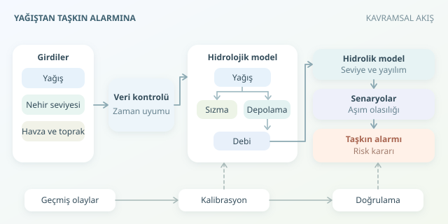

Bir havzayı dev bir sünger, nehri de bu süngerin tahliye kanalı gibi düşünün. Yağmur başladığında suyun tamamı anında nehre ulaşmaz: Bir kısmı toprağa sızar, bir kısmı depolanır, kalanı akışa geçer. Taşkın tahmini, bu yolculuğu denklemlerle izleyip kritik seviyeye ne zaman yaklaşılacağını hesaplama işidir.

``

## Önce veriyi konuşturalım

Temel girdiler yağış, nehir seviyesi, havza özellikleri ve başlangıçtaki su durumudur. Yağış istasyonları noktasal ölçüm sunarken radar, yağışın mekânsal dağılımını gösterir. Seviye sensörleri ise nehrin mevcut durumunu izlemeyi sağlar. Ancak sensörden gelen her sayı doğrudan modele atılmaz; saat kaymaları, eksik kayıtlar ve ani ölçüm sıçramaları kontrol edilmelidir.

| Veri | Modeldeki görevi | Başlıca belirsizlik |
|---|---|---|
| Yağış | Su girişini belirlemek | Mekânsal örnekleme hatası |
| Nehir seviyesi | Başlangıcı güncellemek | Sensör ve referans kotu hatası |
| Toprak nemi | Sızmayı değerlendirmek | Havzayı temsil edememe |
| Arazi modeli | Akış yollarını belirlemek | Çözünürlük ve kot hatası |




Zaman adımları da eşleştirilmelidir. On dakikalık yağışı saatlik seviyelerle gelişigüzel birleştirmek, filmin sesini görüntüsünden ayrı oynatmaya benzer.

## Temel fizik: Su kaybolmaz, yer değiştirir

Hidrolojik modelin omurgası kütlenin korunmasıdır. Basitleştirilmiş bir akış deposunda:

$$\frac{dV}{dt}=I(t)-Q(t), \qquad Q(t)=\frac{V(t)}{K}$$

Burada $V$ depolanan su hacmi, $I$ giriş debisi, $Q$ çıkış debisi ve $K$ havzanın tepki süresini temsil eden parametredir. Büyük $K$, yağış etkisinin daha yavaş boşalması demektir.

Yağışın akışa dönüşen kısmını ilk yaklaşımda $P_e=\max(P-f,0)$ ile gösterebiliriz. $f$, yağışla aynı birimde tanımlanan kayıp hızıdır. Gerçekte sızma kapasitesi zamanla değişir; doygun toprak, aynı yağış altında kuru toprağa göre daha fazla yüzey akışı üretir. Dolayısıyla sabit kayıp, öğretici ama sınırlı bir kabuldür.

## Hangi model neyi çözer?

| Yaklaşım | Hesapladığı süreç | Önemli gereksinim |
|---|---|---|
| Toplu hidrolojik model | Havzanın toplam debi tepkisi | Kalibre edilmiş parametreler |
| Dağıtılmış hidrolojik model | Mekânsal yağış-akış değişimi | Toprak ve arazi verisi |
| Hidrolik model | Kanal seviyesi ve taşkın yayılımı | Kesitler, topoğrafya, sınır koşulları |

Hidrolojik model genellikle debi üretir; hidrolik model bu debinin kanalda ve taşkın ovasında nasıl ilerlediğini hesaplar. Tek başına debi tahmini, hangi sokağın su altında kalacağını söylemez. Bunun için kanal geometrisi, pürüzlülük, köprüler ve aşağı havza koşulları da gerekir.

## Python ile küçük bir simülasyon

Aşağıdaki örnek, beş dakikalık yağışlardan etkin girdiyi hesaplar ve doğrusal depoyu analitik güncelleyerek debiyi seviyeye dönüştürür:

```python
import numpy as np

rain = np.array([3, 12, 35, 60, 42, 18, 6, 0])  # mm/saat
area, dt, K = 20e6, 300.0, 5400.0  # m², saniye, saniye
loss = 8.0  # mm/saat
h0, a, b = 0.4, 45.0, 1.8
V = 12.0 * K  # başlangıç debisi: 12 m³/s
levels = []

for p in rain:
    inflow = max(p - loss, 0.0) * area / 1000 / 3600
    decay = np.exp(-dt / K)
    V = V * decay + inflow * K * (1 - decay)
    Q = V / K
    levels.append(h0 + (Q / a) ** (1 / b))

print(f"En yüksek örneklenmiş seviye: {max(levels):.2f} m")
```

Burada her yağış değeri bir zaman adımı boyunca sabittir. Üstel güncelleme, bu varsayım altında depolama denkleminin tam çözümüdür; basit Euler yönteminin zaman adımına bağlı kararsızlığını önler. Ancak zaman çözünürlüğü hâlâ önemlidir.

Seviye dönüşümü $Q=a(h-h_0)^b$ anahtar eğrisine dayanır. Katsayılar tamamen örnektir; gerçek kullanımda eşzamanlı debi-seviye ölçümleriyle belirlenmelidir. Geri su etkisi ve taşkındaki histerezis, tek değerli eğriyi yetersiz bırakabilir.

## Tek çizgi yerine olasılık üretin

Gelecekteki yağış bilinmediğinden tahmin girdileri meteorolojik öngörülerden gelir. Farklı yağış senaryoları, başlangıç nemleri ve parametrelerle çok sayıda koşum yapılabilir. Kritik seviye $h_c$ için:

$$\hat{p}=\frac{N_{\mathrm{aşım}}}{N_{\mathrm{toplam}}}$$

Bu oran, uygun oluşturulmuş toplulukta eşik aşım olasılığının tahminidir; otomatik olarak güvenilir bir yüzde değildir. Geçmiş olaylarla olasılık kalibrasyonu kontrol edilmelidir. Güncel seviye gözlemleriyle durum güncellemesi yapmak da başlangıç hatasını azaltabilir.

## Son sınav: Geçmiş taşkınlar

Kalibrasyon ve değerlendirme olaylarını zaman içinde ayırın. Seviye hatasını, tepe zamanını, kaçırılan taşkınları ve yanlış alarmları birlikte ölçün. Ortalama hatası düşük bir model, kritik yükselişi geç yakalıyorsa operasyonel olarak başarısız olabilir. Öngörü süresi uzadıkça becerinin nasıl değiştiğini ayrıca raporlayın.

Bu örnek bir eğitim iskeletidir; gerçek uyarı sistemi yerel doğrulama, sensör sürekliliği, belirsizlik analizi ve yetkili kurumların prosedürlerini gerektirir. Amaç sihirli küre yapmak değil, belirsizliği ölçülebilir ve karar verilebilir hâle getirmektir.
