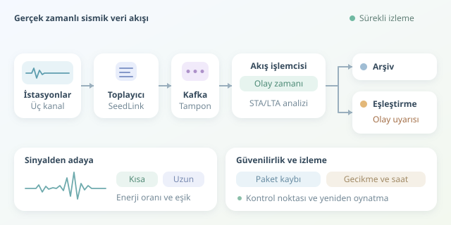

Yüzlerce sismik istasyonun aynı anda konuştuğunu düşünün: Her biri, yerin titreşimlerini hiç susmadan anlatıyor. Görevimiz bu dev koroyu dinlemek, eksik notaları fark etmek ve anlamlı hareketleri hızla ayırt etmek. Buradaki “gerçek zamanlı”, sıfır gecikme değil; ölçülen ve uygulamanın ihtiyacını karşılayan, düşük gecikme demektir.

``

## İstasyondan analiz motoruna

Sismometre, yer hareketini ölçer; sayısallaştırıcı ise analog sinyali belirli örnekleme frekansında sayılara dönüştürür. Sayısallaştırma öncesindeki uygun filtreleme, yüksek frekansların yanlış frekanslar gibi görünmesini, yani aliasing sorununu önler. Üç bileşenli bir istasyon, hareketi farklı yönlerde kaydeder. Böylece tek istasyondan bile birkaç paralel veri akışı oluşur.

Tipik hat şöyledir: **İstasyon → SeedLink toplayıcı → Kafka → akış işlemcisi → arşiv ve uyarı servisi.** SeedLink aktarımda, miniSEED ise sismik kayıtların paketlenmesinde sık kullanılır. Kafka, üreticilerle tüketicileri ayıran dayanıklı bir tampon görevi görür.

Ham veri hızını yaklaşık hesaplayalım:

$$R=N_{istasyon} \times N_{kanal} \times f_s \times b$$

300 istasyon, üç kanal, 100 Hz örnekleme ve örnek başına dört bayt için sonuç **360.000 bayt/saniye** olur. Bu, sıkıştırma, başlıklar ve çoğaltma hariç günde yaklaşık 31 GB eder. Asıl mesele yalnızca hacim değil, sürekliliktir.

| Özellik | Toplu işleme | Akış işleme |
|---|---|---|
| Başlama koşulu | Dosyanın tamamlanması | Paketin ulaşması |
| Hesaplama birimi | Büyük veri kümesi | Sürekli güncellenen pencere |
| Geç veri | Yeniden çalıştırma | Gecikme politikası ve düzeltme |
| Kurtarma | Dosyadan tekrar | Kontrol noktası ve yeniden oynatma |

## İki saat, bir gerçek

Paketin sunucuya geliş zamanı ile ölçüm zamanı aynı değildir. Analizde **olay zamanı**, yani örneğin istasyonda kaydedildiği zaman kullanılmalıdır. Aksi hâlde ağdaki gecikme, yeraltındaki fiziksel gecikmeyle karışır.

Kafka anahtarını istasyon ve kanal kimliğinden oluşturmak, ilgili kayıtları aynı bölüme yönlendirir. Ancak bu, ölçüm sırasını kendiliğinden garanti etmez: Yeniden bağlantılar eski paketler getirebilir. Flink gibi işlemcilerde watermark, olay zamanının ilerleyişini takip eder; sıra dışı veriler için tolerans tanımlanır. Daha uzun beklemek doğruluğu artırabilir ama alarmı geciktirir.

## Gürültüden adaya: STA/LTA

Basit bir başlangıç, kısa ve uzun pencerelerdeki ortalama enerjiyi karşılaştırmaktır:

$$Q(t)=\frac{STA(x^2)}{LTA(x^2)+\epsilon}$$

STA hızlı değişimi, LTA arka planı temsil eder. Oran yükseldiğinde olay adayı oluşur; tek başına deprem doğrulanmış olmaz. Pencere süreleri ve eşikler, istasyon gürültüsüne göre ayarlanmalıdır.

Aşağıdaki Python çekirdeği, 100 Hz hızındaki **sıralı ve kesintisiz** örnekler için kanal bazında durum tutar:

```python
from collections import deque

states = {}

def update(window, total, value):
    if len(window) == window.maxlen:
        total -= window[0]
    window.append(value)
    return total + value

def process(key, sample):
    if key not in states:
        states[key] = {
            "short": deque(maxlen=50),
            "long": deque(maxlen=1000),
            "ss": 0.0, "ls": 0.0, "active": False
        }
    s = states[key]
    energy = float(sample) ** 2
    s["ss"] = update(s["short"], s["ss"], energy)
    s["ls"] = update(s["long"], s["ls"], energy)
    if len(s["long"]) < 1000:
        return False
    ratio = (s["ss"] / 50) / (s["ls"] / 1000 + 1e-12)
    onset = ratio > 3.5 and not s["active"]
    if onset:
        s["active"] = True
    elif ratio < 1.5:
        s["active"] = False
    return onset
```

Kod, kayan toplamlarla her örneği sabit işlem maliyetiyle değerlendirir. Farklı açılma ve kapanma eşikleri, alarmın sürekli yanıp sönmesini azaltır. Üretimde önce ofset giderme ve uygun filtreleme uygulanmalı; zaman boşluğu veya örnekleme hızı değişimi görülürse durum sıfırlanmalıdır. Eksik örnekleri sıfırla doldurmak sahte geçişler yaratabilir.

## Tek istasyona güvenmeyin

Kamyon geçişi de güçlü sinyal üretebilir. Bu yüzden adaylar, birden fazla istasyondaki varış zamanlarıyla ilişkilendirilir. İstasyon konumları, saat doğruluğu ve dalga yayılım modeli birlikte değerlendirilir. Basit eşzamanlılık kontrolü başlangıçtır; güvenilir konumlama için P/S faz seçimi ve seyahat zamanı hesabı gerekir. Bu süreç, depremi önceden tahmin etmek değildir.

## Sistemin kendisini de dinleyin

Paket kaybı, saat sapması, tüketici geriliği ve uçtan uca gecikmenin p95/p99 değerleri izlenmelidir. Kontrol noktaları hesaplama durumunu korur; Kafka verisi yeniden oynatılabilir. Ancak uçtan uca tekil sonuç için çıktı tarafında da işlemsel yazma veya idempotent olay kimlikleri gerekir. Trafik artışlarını karşılayacak kapasite payı bırakmak, yavaş tüketicilerin tüm hattı tıkamasını önler.

Özetle başarılı sistem, sadece hızlı çalışan değil; gecikmesini bilen, veri kalitesini denetleyen ve kesintiden sonra tutarlı biçimde toparlanabilen sistemdir.



